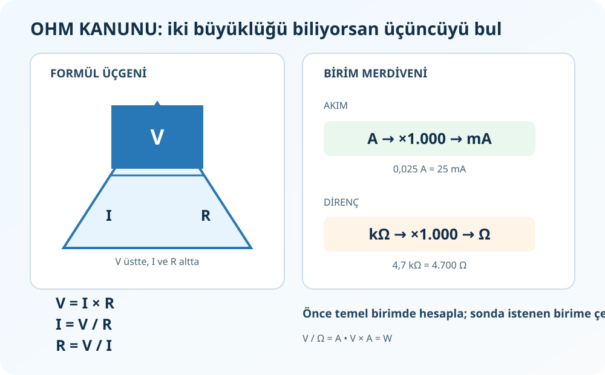
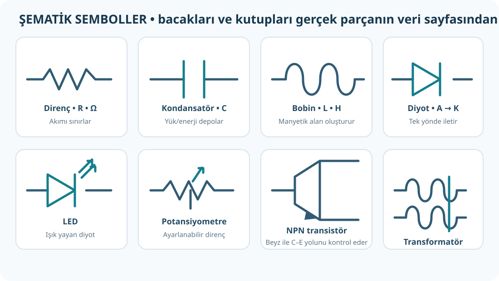
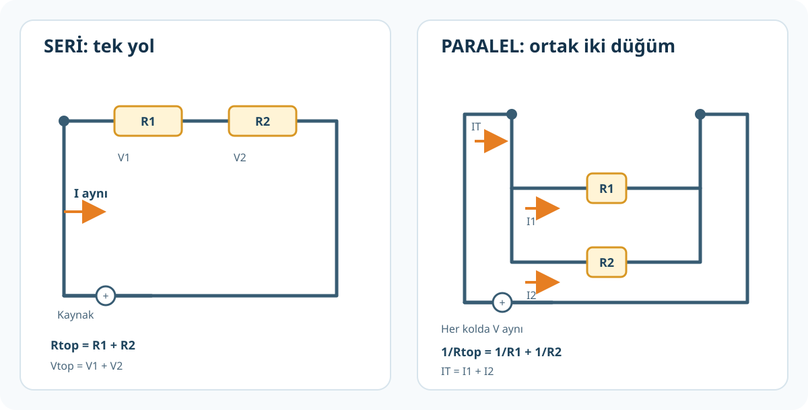
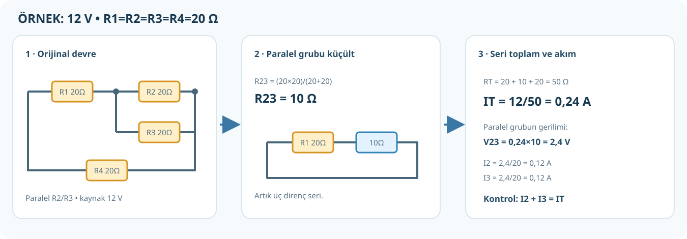
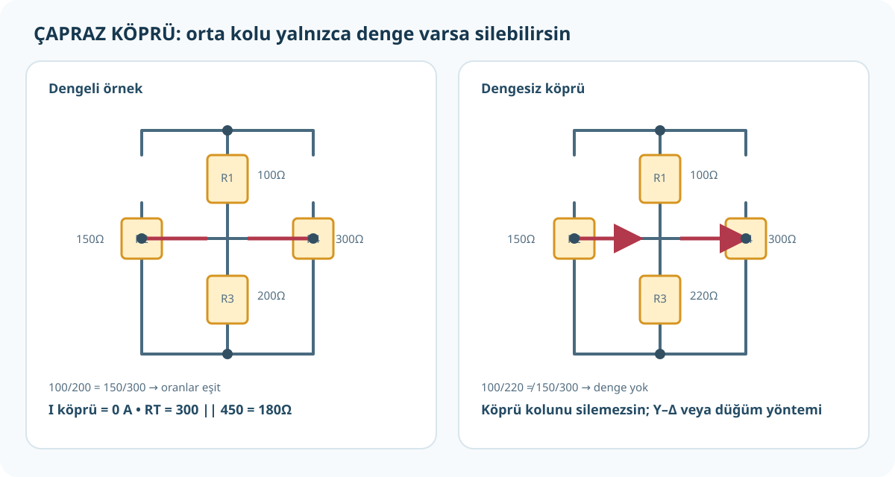
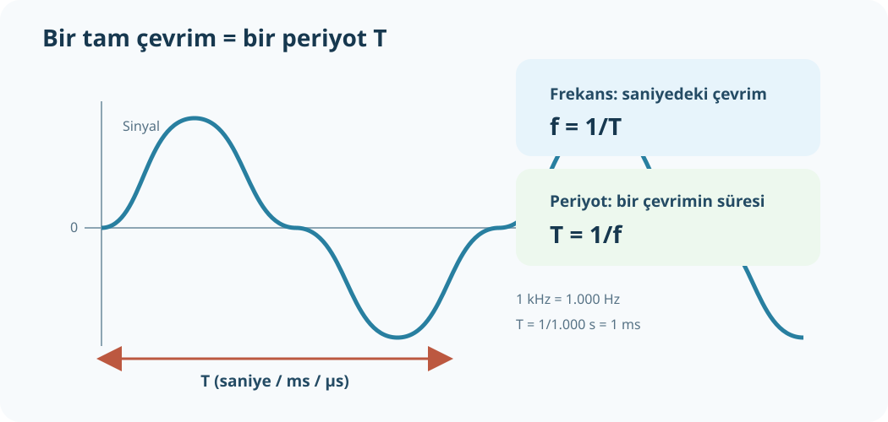
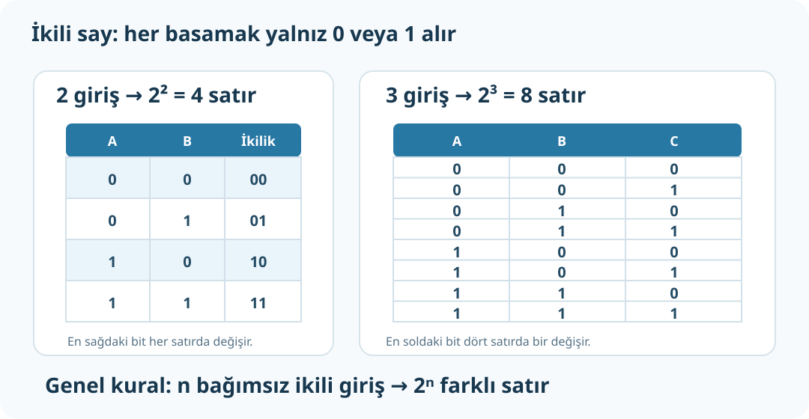
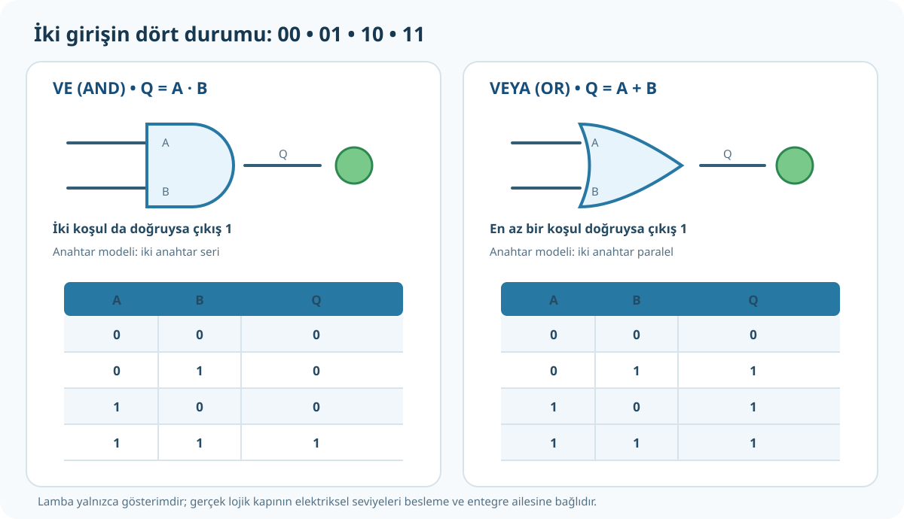
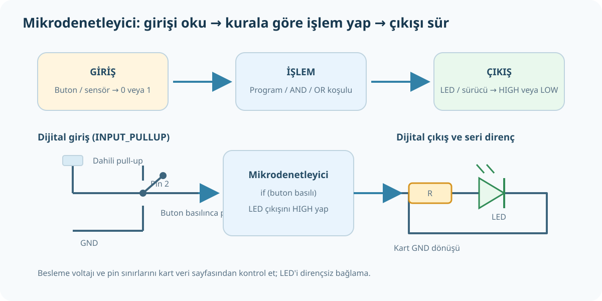

# Görsel Destekli Elektronik ve Mikrodenetleyici Ders Kitabı

> Bu dosya `tools/build_book.py` ile bölüm Markdown dosyalarından üretilir. Bölümleri düzenledikten sonra aynı komutu yeniden çalıştırın.

## İçindekiler

- [Elektronik Uygulamaları: Elektronik Uygulamaları — Ders Haritası](#chapter-01)
- [Elektronik Uygulamaları: Elektriksel Büyüklükler ve Birimler](#chapter-02)
- [Elektronik Uygulamaları: Devre Elemanları: Ne İşe Yarar, Nasıl Tanınır?](#chapter-03)
- [Elektronik Uygulamaları: Ohm Kanunu ve Güç — Hangi Formül, Hangi İşlem?](#chapter-04)
- [Elektronik Uygulamaları: Seri, Paralel ve Karışık Devreler](#chapter-05)
- [Elektronik Uygulamaları: Çapraz Çizilmiş Devre, Wheatstone Köprüsü ve Yıldız-Üçgen](#chapter-06)
- [Elektronik Uygulamaları: Ölçü Aletleri: Nereye Bağlanır, Nasıl Kullanılır?](#chapter-07)
- [Elektronik Uygulamaları: Frekans, Periyot ve Hz–kHz–MHz](#chapter-08)
- [Elektronik Uygulamaları: Elektronik Alıştırmaları — Çözümleriyle](#chapter-09)
- [Mikrodenetleyici: Mikrodenetleyici — Sayı Sistemleri ve Mantık Kapıları](#chapter-10)
- [Mikrodenetleyici: İkili Sayı Sistemi, Sayma ve Taban Dönüşümleri](#chapter-11)
- [Mikrodenetleyici: Doğruluk Tablosu, VE ve VEYA Kapıları](#chapter-12)
- [Mikrodenetleyici: NOT, NAND, NOR, XOR ve XNOR Kapıları](#chapter-13)
- [Mikrodenetleyici: Mikrodenetleyici, HIGH/LOW, Buton ve LED](#chapter-14)
- [Mikrodenetleyici: Sayı Sistemleri ve Lojik Kapılar — Alıştırmalar](#chapter-15)
- [Sınava Odaklı Çalışma: Sınava Odaklı Çalışma — Hangi Sınav?](#chapter-16)
- [Sınava Odaklı Çalışma: Sınava Odaklı Çalışma — 1. Senaryo (Elektronik Uygulamaları)](#chapter-17)
- [Sınava Odaklı Çalışma: Elektronik Uygulamaları — 1. Senaryo Sınav Çalışması](#chapter-18)
- [Sınava Odaklı Çalışma: 1. Senaryo Deneme Sınavı — Elektronik Uygulamaları (8 soru)](#chapter-19)
- [Sınava Odaklı Çalışma: Sınava Odaklı Çalışma — 2. Senaryo (Elektronik Uygulamaları)](#chapter-20)
- [Sınava Odaklı Çalışma: Elektronik Uygulamaları — Sınav Çalışması](#chapter-21)
- [Sınava Odaklı Çalışma: Deneme Sınavı ve Cevap Anahtarı](#chapter-22)
- [Sınava Odaklı Çalışma: Mikrodenetleyici — Sınav Hazırlığı (2. Senaryo)](#chapter-23)
- [Sınava Odaklı Çalışma: Mikrodenetleyici — Sayı Sistemleri ve Sayısal İşlemler (3 soru)](#chapter-24)
- [Sınava Odaklı Çalışma: Mikrodenetleyici — Lojik Kapılar ve Entegre ile Devre Kurma (2 soru)](#chapter-25)
- [Sınava Odaklı Çalışma: Mikrodenetleyici Deneme Sınavı (5 soru) ve Cevaplar](#chapter-26)


---

<a id="chapter-01"></a>

# Elektronik Uygulamaları — Ders Haritası

**Kaynak:** *Elektronik Uygulamaları*, PDF 1–72; içerik PDF 18'de başlar.

## Bu bölümde neler var?

| PDF sayfası | Konu | Rehber |
|---:|---|---|
| 18–25 | Direnç, öz direnç, çeşitler, renk kodu | [Devre elemanları](docs/elektronik/02-devre-elemanlari.md) |
| 26–33 | Kondansatör, kapasite, kod okuma | [Devre elemanları](docs/elektronik/02-devre-elemanlari.md) |
| 34–36 | Bobin, indüktans, AC/DC davranışı | [Devre elemanları](docs/elektronik/02-devre-elemanlari.md) |
| 37–43 | Diyot çeşitleri ve ölçümü | [Devre elemanları](docs/elektronik/02-devre-elemanlari.md), [ölçüm](docs/elektronik/06-olcum-ve-guvenlik.md) |
| 44–49 | NPN/PNP transistor, anahtar kullanımı | [Devre elemanları](docs/elektronik/02-devre-elemanlari.md) |
| 50–52 | Transformatör | [Devre elemanları](docs/elektronik/02-devre-elemanlari.md) |
| 54–60 | Seri devre | [Seri-paralel devreler](docs/elektronik/04-seri-paralel-karisik.md) |
| 60–64 | Paralel devre | [Seri-paralel devreler](docs/elektronik/04-seri-paralel-karisik.md) |
| 64–67 | Karışık devre ve ölçüm | [Seri-paralel devreler](docs/elektronik/04-seri-paralel-karisik.md) |
| 68–69 | Devre değerlendirme soruları 11–15 | [Çözümlü cevaplar](docs/elektronik/08-alistirmalar.md) |
| 70–72 | Doğru akıma giriş, kaynak türleri | [Büyüklükler](docs/elektronik/01-buyuklukler-birimler.md), [ölçüm](docs/elektronik/06-olcum-ve-guvenlik.md) |

## Önerilen öğrenme yolu

1. Önce [gerilim, akım, direnç ve birimleri](docs/elektronik/01-buyuklukler-birimler.md) öğren.
2. [Ohm Kanunu](docs/elektronik/03-ohm-kanunu-ve-guc.md) formül üçlüsünün ne bulduğunu anla.
3. Devre elemanlarının isim, sembol ve görevlerini [buradan](docs/elektronik/02-devre-elemanlari.md) çalış.
4. Devre topolojisini tanı ve [seri-paralel soruları](docs/elektronik/04-seri-paralel-karisik.md) çöz.
5. Hangi büyüklüğün sorulduğunu, aletin devreye nasıl bağlandığını [ölçüm bölümünden](docs/elektronik/06-olcum-ve-guvenlik.md) öğren.
6. Sonra [alıştırmaları](docs/elektronik/08-alistirmalar.md) çözüp cevap anahtarıyla kontrol et.
7. Çapraz köprü soruları gelirse [ek köprü bölümüne](docs/elektronik/05-kopru-yildiz-ucgen.md) geç.

## Soruya başlamadan önce kendine sor

- Benden **eşdeğer direnç**, **toplam akım**, **kol akımı**, **gerilim** veya **güç** mü isteniyor?
- Kaynağın gerilimi ve dirençlerin birimleri birbiriyle uyumlu mu?
- Bu elemanlar gerçekten seri/paralel mi, yoksa yalnızca öyle çizilmiş gibi mi duruyor?
- Sonucu amper mi, miliamper mi; ohm mu, kiloohm mu yazmalıyım?

> **Ek konular:** Frekans/periyot, güç verimi ve köprü dönüşümleri ilk 72 sayfanın kapsamını aşan tamamlayıcı açıklamalardır; ilgili sayfalarda ayrıca işaretlenmiştir.


---

<a id="chapter-02"></a>

# Elektriksel Büyüklükler ve Birimler

**Kaynak:** *Elektronik Uygulamaları* PDF 18–19, 26–27, 34–35, 70–72. **Frekans/periyot** eki kitapta bu sayfa aralığının dışındadır.

## 1. Dört temel büyüklük

| Büyüklük | Harf | Birim | Basit anlatım | Örnek |
|---|---|---|---|---|
| Gerilim | `V` | volt (V) | Yükleri devrede hareket ettiren elektriksel fark | 9 V pil |
| Akım | `I` | amper (A) | İletkenden geçen elektrik yükü akış hızı | 0,02 A |
| Direnç | `R` | ohm (Ω) | Akım akışına karşı koyma | 470 Ω |
| Güç | `P` | watt (W) | Elektrik enerjisinin kullanılma/dönüşme hızı | 2 W |

Su benzetmesi yalnızca ilk sezgi içindir: gerilimi basınca, akımı akışa, direnci dar boruya benzetebilirsin. Elektrik devresindeki gerçek davranışı hesaplamak için yine devre yasalarını kullan.



## 2. Ön ekler: k, M, m ve µ

Ön ek, sayının kaç kat büyük veya küçük olduğunu gösterir. **Büyük ve küçük harf önemlidir:** `m` mili, `M` mega demektir.

| Ön ek | Değer | Örnek |
|---|---:|---|
| giga `G` | `10⁹` | `1 GHz = 1.000.000.000 Hz` |
| mega `M` | `10⁶` | `1 MΩ = 1.000.000 Ω` |
| kilo `k` | `10³` | `1 kΩ = 1.000 Ω` |
| temel birim | `1` | `1 A`, `1 Ω`, `1 Hz` |
| mili `m` | `10⁻³` | `1 mA = 0,001 A` |
| mikro `µ` | `10⁻⁶` | `1 µA = 0,000001 A` |
| nano `n` | `10⁻⁹` | `1 nF = 0,000000001 F` |
| piko `p` | `10⁻¹²` | `1 pF = 0,000000000001 F` |

### Sık kullanılan dönüşümler

- Akım: `1 A = 1.000 mA`; `1 mA = 0,001 A`; `1 A = 1.000.000 µA`.
- Direnç: `1 MΩ = 1.000 kΩ = 1.000.000 Ω`; `1 kΩ = 1.000 Ω`.
- Güç: `1 kW = 1.000 W`; `1 W = 1.000 mW`.
- Frekans (ek): `1 kHz = 1.000 Hz`; `1 MHz = 1.000 kHz`; `1 GHz = 1.000 MHz`.
- Kapasite: `1 F = 1.000 mF = 1.000.000 µF`; `1 µF = 1.000 nF = 1.000.000 pF`.
- Zaman (ek): `1 s = 1.000 ms = 1.000.000 µs`.

**Örnek:** `0,025 A` kaç mA?

`1 A = 1.000 mA`, dolayısıyla `0,025 × 1.000 = 25 mA`.

**Örnek:** `4,7 kΩ` kaç Ω?

`1 kΩ = 1.000 Ω`, dolayısıyla `4,7 × 1.000 = 4.700 Ω`.

### Birimleri işlemin içinde sadeleştir

Ohm Kanunu'nda `V / Ω = A`. Örneğin `12 V / 240 Ω = 0,05 A = 50 mA`. Önce sonucu temel birimle bul; en sonda sorunun istediği birime çevir.

## 3. Frekans ve periyot — ek konu

- Frekans `f`, bir saniyedeki tekrar sayısıdır; birimi hertz (Hz).
- Periyot `T`, bir tam tekrarın sürdüğü zamandır; birimi saniye (s).
- Birbirlerinin tersidir: `f = 1/T`, `T = 1/f`.

Örnek: Sinyal saniyede 1.000 kez tekrarlanıyorsa `f=1.000 Hz=1 kHz`; `T=1/1.000 s=0,001 s=1 ms`.

**Karıştırma:** `mA` bir akım; `MHz` bir frekans; `ms` bir zamandır. Her biri farklı fiziksel büyüklük olduğundan birbirine dönüştürülemez.

## Alıştırma

1. `0,003 A` kaç mA?
2. `2,2 kΩ` kaç Ω?
3. `470 nF` kaç µF?
4. Frekansı `50 Hz` olan bir sinyalin periyodu kaç ms? (Ek konu)

**Cevap:** 1) `3 mA`. 2) `2.200 Ω`. 3) `0,47 µF`. 4) `T=1/50 s=0,02 s=20 ms`.


---

<a id="chapter-03"></a>

# Devre Elemanları: Ne İşe Yarar, Nasıl Tanınır?

**Kaynak:** *Elektronik Uygulamaları* PDF 18–52. Çizimler kavramları anlatan özgün sembollerdir; kaynak kitap görsellerinin kopyası değildir.



## 1. Direnç ve bakır iletken

Direnç (`R`), akımı sınırlar/belirli bir değere ayarlar. Birimi ohm (Ω). Sabit direnç, potansiyometre, trimpot, reosta ve ışık/sıcaklıkla değişen direnç türleri bulunur.

- **Potansiyometre:** Döner kol ile ayarlanan, çoğunlukla üç uçlu değişken direnç.
- **Trimpot:** Devre kalibrasyonu için tornavidayla ayarlanır.
- **Reosta:** Daha yüksek güçlerde değişken direnç olarak tasarlanır.
- **LDR:** Işık arttıkça direnci genellikle azalır.
- **NTC:** Sıcaklık arttıkça direnci azalır.
- **PTC:** Sıcaklık arttıkça direnci artar.
- **Renk kodu:** 4 bantlı dirençte ilk iki bant rakam, üçüncü çarpan, son bant toleranstır. Örnek: sarı-mor-turuncu-altın → `47 × 1.000 Ω = 47 kΩ ±%5`.

Tel için direnç yaklaşık `R = ρL/A` ile bulunur. Bakır için kitapta verilen yaklaşık öz direnç `ρ=0,0178 Ω·mm²/m`; `L` metre, `A` mm² olmalı. Tel uzadıkça direnç artar, kesiti büyüdükçe azalır.

**Örnek:** 10 m uzunluk ve 1,5 mm² kesit: `R=0,0178×10/1,5≈0,119 Ω`. İki telli gidiş-dönüş bağlantıda toplam tel uzunluğu yaklaşık 20 m olur; direnç yaklaşık `0,237 Ω` çıkar.

> Bu bağıntı ile bir bağlantı telinin direnci hesaplanır. Kontrollü akım sınırlamak için değeri ve güç kapasitesi uygun bir direnç seçilir. İnce teli bilerek ısıtmak güvenli bir güç dönüştürme yöntemi değildir.

## 2. Kondansatör

Kondansatör (`C`), elektrik yükünü/enerjisini elektrik alanında depolar; kapasitesi farad (F). Plakaların alanı ve yalıtkanın dielektrik katsayısı arttıkça kapasite artar; plakalar arası mesafe arttıkça azalır.

- Elektrolitik kondansatör çoğunlukla kutupludur. `+`/`−` uçlarını ters bağlama ve üstündeki gerilim sınırını aşma.
- Seramik/film kondansatörler genellikle kutupsuzdur.
- Kod `104`: ilk iki anlamlı rakam `10`, son rakam pF cinsinden sıfır sayısı `4` → `100.000 pF = 100 nF = 0,1 µF`.
- LCR metre, L (indüktans), C (kapasite), R (direnç) ölçmek için kullanılabilir.

## 3. Bobin

Bobin (`L`), sarılmış iletkendir; birimi henry (H). Akım değişimine karşı koyan manyetik alan oluşturur. DC kararlı hâle geldiğinde esas olarak tel direnci, AC'de ise frekansa ve indüktansa bağlı endüktif reaktans etkilidir. Güç kaynaklarında filtreleme, sinyal ve frekans devrelerinde kullanılır.

## 4. Diyot, LED ve zener

- **Diyot:** Anot (A) ve katot (K) uçludur; ileri yönde iletir, ters yönde büyük ölçüde engeller. Fiziksel diyotta çizgili uç genellikle katodu gösterir.
- **LED:** Işık yayan diyottur; doğru kutuplanır ve akımı sınırlamak için uygun seri dirençle kullanılır.
- **Zener:** Uygun ters kutuplamada ve anma değerleri içinde gerilimi sınırlama/sabitleme için kullanılır.
- **Köprü diyot:** Dört diyotla alternatif akımı doğrultmaya yarar.
- **Diyot testi:** Enerjisi kesilmiş devrede multimetre diyot moduna alınır. Bir yönde ileri gerilim düşümü, ters yönde açık devre okunması genellikle sağlamlık işaretidir.

## 5. BJT transistör

Uçları kolektör (C), beyz (B), emiter (E). Beyz-emiter girişindeki küçük akım, kolektör-emiter yolundaki daha büyük akımı kontrol edebilir; bu yüzden anahtar veya yükselteç olarak kullanılır.

- **NPN:** Bazı kaynak şemalarında emiter oku dışarı doğrudur; doğru çalışma kutuplaması PNP'nin tersidir.
- **PNP:** NPN'ye göre kutuplama yönü tersidir.
- Anahtar: beyz sürülmüyorsa kesim/kapalı; yeterli baz sürmesiyle doyum/açık.
- Bacak dizilimi modelden modele değişir; parça veri sayfasına bak. Kılıf şekline göre tahmin etme.

## 6. Transformatör

İki sargı ve manyetik nüve üzerinden **değişen akımla/AC ile** enerji aktarır. Alçaltıcı tip gerilimi düşürür; yükseltici artırır; izolasyon tipi iki devreyi elektriksel olarak ayırır. Gerilim dönüşümü akım ve güç ilişkisiyle birlikte düşünülmelidir; gerçek elemanda kayıp bulunur. Transformatör tek başına “500 W'ı 50 W'a ayarlamaz”.

## Kendini dene

1. Işık arttıkça direnci azalan eleman hangisi?
2. Sıcaklık artınca direnci artan ve azalan termistörlerin adları ne?
3. `104` kondansatör kodunun değeri?
4. Diyotun katot ucunu tanımaya yarayan yaygın gövde işareti nedir?

**Cevap:** 1) LDR. 2) PTC artar, NTC azalır. 3) `100 nF = 0,1 µF`. 4) Katot tarafındaki bant/çizgi (parça tipini yine veri sayfasıyla doğrula).


---

<a id="chapter-04"></a>

# Ohm Kanunu ve Güç — Hangi Formül, Hangi İşlem?

**Kaynak:** Elektriksel büyüklükler ve devre ilkeleri, *Elektronik Uygulamaları* PDF 18–19 ve 54–65. Güç uygulamalarına dair ek örnekler bu notta ayrıca işaretlidir.


## 1. V, I, R üçlüsü

```text
      V
    -----
     I × R
```

| Sorulan | Formül | Bulduğun |
|---|---|---|
| Gerilim? | `V = I × R` | volt (V) |
| Akım? | `I = V / R` | amper (A) |
| Direnç? | `R = V / I` | ohm (Ω) |

`V` gerilim, `I` akım, `R` dirençtir. Yani verilen iki büyüklüğü formüle koyup üçüncüyü bulursun.

**Örnek:** 12 V kaynağa 4 Ω yük bağlanmış. Akım isteniyor:

1. Bilinenler: `V=12 V`, `R=4 Ω`.
2. İstenen `I`; formülde yalnız bırak: `I=V/R`.
3. Yerine koy: `I=12/4=3 A`.
4. Birim kontrolü: `V/Ω=A`.

`I=V/R`, **bu dirençten** geçen akımı verir. Toplam kaynak akımı soruluyorsa `R` yerine devrenin eşdeğeri `R_T` kullanılır. Bir kol soruluyorsa o kola düşen gerilimi ve kol direncini kullan.

## 2. Güç ne demek?

Güç `P`, elektrik enerjisinin kullanım/dönüşüm hızıdır; birimi watt (W). Dirençli yükler için:

- `P = V × I`
- `P = I² × R`
- `P = V² / R`

`I²`, akımın karesi; `V²`, gerilimin karesi demektir. Üç ifade Ohm Kanunu kullanılarak birbirinden elde edilir. Elindeki verilere uyanı seç; birim kontrolü yap (`V×A=W`).

**Örnek:** 12 V'ta 4 A çeken yük: `P=12×4=48 W`.

## 3. 500 W / 50 W sorusunu doğru ayır

“500 W'lık kaynaktan 50 W almak” iki ayrı durumu anlatabilir:

**Kaynak en çok 500 W sağlayabiliyor, yük 50 W istiyor:** Bu normaldir. Uygun gerilimde yük ihtiyacı kadar akım çeker. Örneğin 12 V, 50 W yük `I=P/V=50/12≈4,17 A` çeker. Kaynağın 500 W kapasitesi yükü 500 W'a zorlamaz.

**Gerçek giriş 500 W, yararlı çıkış 50 W ise:** Verim `η=P_out/P_in×100%=10%`; yaklaşık `450 W` kayıp çoğunlukla ısıya dönüşür. Bu normal/verimli bir düşürme yöntemi değildir.

“500 V'tan 50 V'a” denmek isteniyorsa bu watt değil **gerilim** değeridir. Uygun AC transformatörü veya DC-DC dönüştürücü seçmek gerekir; basit seri direnç özellikle yüksek güçte güvenli çözüm değildir.

## İşlem kontrol listesi

1. Soru benden hangi büyüklüğü istiyor?
2. Devrede o büyüklüğü belirleyen doğru direnç/gerilim hangisi?
3. Birimleri temel birimde mi?
4. Formülün sonucu istenen fiziksel büyüklük mü?
5. Akım amper çıktıysa ve soru mA istiyorsa `×1.000` yaptım mı?
6. Watt hesabında hem gerilim hem akımı hesaba kattım mı?

## Alıştırma

1. 9 V kaynağa 3 kΩ bağlanıyor. Akım kaç mA?
2. 6 V gerilimle 0,2 A akım alan yükün gücü kaç W?
3. 2 W ve 100 Ω dirençte akım `I=√(P/R)` ile kaç A? (Ek formül uygulaması)

**Cevap:** 1) `9/3.000=0,003 A=3 mA`. 2) `6×0,2=1,2 W`. 3) `√(2/100)=√0,02≈0,141 A`.


---

<a id="chapter-05"></a>

# Seri, Paralel ve Karışık Devreler

**Kaynak:** *Elektronik Uygulamaları* PDF 54–69. Devre şekilleri öğretim için yeniden çizilmiştir; karşılık gelen kaynak PDF sayfaları aşağıda yazılıdır.



## 1. Seri bağlantı

Elemanlar uç uca ve tek akım yolu üzerindedir. Arada başka kol yoktur.

- Aynı akım her elemandan geçer: `I_T = I_1 = I_2`.
- Eşdeğer dirençler toplanır: `R_T = R_1 + R_2 + ...`.
- Kaynak gerilimi dirençlere bölünür: `V_T = V_1 + V_2 + ...`.
- Her dirençte `V_n = I × R_n`.

**Örnek:** 12 V kaynağa 2 Ω ve 4 Ω seri.

1. `R_T=2+4=6 Ω`.
2. `I_T=12/6=2 A`. Bu akım iki dirençten de 2 A geçer.
3. `V_1=2×2=4 V`; `V_2=2×4=8 V`.
4. Kontrol: `4+8=12 V`.

### Kaynak kitap seri örneği

PDF 59–60'da seri bağlantıda devre akımının her elemanda aynı olduğu ve voltmetrenin eleman uçlarına paralel bağlandığı anlatılır. PDF 68'de üç seri direnç sorusunun çözümü [alıştırmalar sayfasındadır](docs/elektronik/08-alistirmalar.md).

## 2. Paralel bağlantı

Her direnç aynı iki düğüm arasına bağlanır. Kollar ayrı akım yolu oluşturur.

- Kolların uçları aynı düğümlerde olduğundan gerilim aynı: `V_1=V_2=V`.
- Akım kollara bölünür: `I_T=I_1+I_2+...`.
- `I_n=V/R_n`; direnci küçük kola daha fazla akım gider.
- İki direnç için `R_T=(R_1×R_2)/(R_1+R_2)`.
- Genel formül: `1/R_T=1/R_1+1/R_2+...`.
- Eşdeğer direnç en küçük paralel dirençten küçüktür.

**Örnek:** 12 V'ta 6 Ω ve 3 Ω paralel.

1. `R_T=(6×3)/(6+3)=2 Ω`.
2. `I_1=12/6=2 A`; `I_2=12/3=4 A`.
3. `I_T=2+4=6 A`. Kontrol: `12/2=6 A`.

### Aklında kalsın

**Paralelde aynı olan gerilim; ayrılan ve toplanan akımdır.** Her direncin uçlarının gerçekten aynı iki düğüme bağlı olduğunu izleyerek doğrula.

## 3. Karışık devreyi çözme



### Her soruda uygulayacağın 8 adım

1. Kaynağı, dirençleri ve sorulanı yaz.
2. Bağlantı düğümlerini takip et; şeklin görünüşüne aldanma.
3. Önce içteki seri/paralel grubu seç.
4. O grubu eşdeğer dirençle değiştirip yeni, küçük bir devre çiz.
5. Tek bir `R_T` kalana kadar sadeleştir.
6. Toplam kaynak akımını `I_T=V/R_T` ile bul.
7. Orijinal devreye geri dön: seri akımlarını eşitle; paralel gerilimlerini eşitle; her bir elemanı `V=IR` ile hesapla.
8. Kontrol: seri gerilimler kaynak gerilimine, paralel kol akımları ana akıma eşit mi?

> **Yanlış yöntem:** Şemadaki telleri sadece yeniden kıvırıp dirençleri başka düğümlere taşımak bağlantıyı değiştirebilir. Yalnızca iletken üzerinde eleman bulunmayan aynı düğümü sayfa üzerinde farklı biçimde çizebilirsin.

## 4. Tam çözümlü karışık devre (kitap PDF 64–66, Görsel 2.19)

Devre: `R1=R2=R3=R4=20 Ω`, kaynak `12 V`; `R1` seri, `R2` ile `R3` paralel, `R4` tekrar seri.

### A. Toplam akımı bul

1. Paralel grup: `R_23=(20×20)/(20+20)=400/40=10 Ω`.
2. Seri toplam: `R_T=20+10+20=50 Ω`.
3. Kaynak akımı: `I_T=12/50=0,24 A=240 mA`.

### B. Her elemanı bul

4. `R1` ve `R4` seri yolda olduğundan her ikisinden de `240 mA` geçer.
5. Bu dirençlerdeki gerilim: `V_R1=0,24×20=4,8 V`; `V_R4=4,8 V`.
6. Paralel gruba düşen gerilim: `12−4,8−4,8=2,4 V`.
7. Paralel dirençlerin her birinde `2,4 V` bulunur.
8. `I_R2=2,4/20=0,12 A=120 mA`; `I_R3=120 mA`.
9. Kontrol: `120+120=240 mA`; `4,8+2,4+4,8=12 V`.

| Eleman | Akım | Gerilim |
|---|---:|---:|
| R1 | 240 mA | 4,8 V |
| R2 | 120 mA | 2,4 V |
| R3 | 120 mA | 2,4 V |
| R4 | 240 mA | 4,8 V |

## 5. PDF 68–69'daki şekilli soruların kısa yanıtları

| PDF soru | Devre özeti | Çözüm sonucu |
|---:|---|---:|
| 11 | 100 Ω + 300 Ω + 600 Ω seri | `R_T=1.000 Ω` |
| 12 | 3 kΩ paralel 6 kΩ | `R_T=2 kΩ` |
| 13 | 3 kΩ seri (6 kΩ paralel 3 kΩ) | `R_T=5 kΩ` |
| 14 | 15 V, 3 Ω seri (6 Ω paralel 3 Ω), ampermetre ana hatta | `I_T=3 A` |
| 15 | 15 V, 3 Ω seri (6 Ω paralel 3 Ω), voltmetre paralel kolda | `V_ölçülen=6 V` |

Tüm işlem basamakları ve nedenleri [alıştırmalarda](docs/elektronik/08-alistirmalar.md).

## Alıştırma

`R1=4 Ω` seri; `R2=12 Ω` ile `R3=6 Ω` paralel; kaynak `18 V`.

1. Eşdeğer direnç nedir?
2. Kaynak akımı kaç A?
3. Paralel grup gerilimi ve iki kol akımı nedir?

**Cevap:** `R23=4 Ω`; `R_T=8 Ω`; `I_T=18/8=2,25 A`. `R1` gerilimi `9 V`; paralel grupta `9 V`. `I2=0,75 A`, `I3=1,5 A`; kol akımları toplamı `2,25 A`.


---

<a id="chapter-06"></a>

# Çapraz Çizilmiş Devre, Wheatstone Köprüsü ve Yıldız-Üçgen

**Ek konu:** Elektronik Uygulamaları PDF 1–72'de Wheatstone köprüsü/yıldız-üçgen bölümü yoktur. Bu sayfa, öğrencinin bahsettiği çapraz çizilmiş devreler için ek devre analizi anlatımıdır.



## 1. Çapraz çizgi görünce hemen devreyi değiştirme

Bir devre şemasının görünüşünü değiştirmek mümkündür; ancak elektrik bağlantılarını değiştirmek mümkün değildir. Düğüm, aralarında devre elemanı bulunmayan ve iletkenle doğrudan bağlı tüm noktalardır.

- İki tel kesişiyor ama kesişme noktasında birleşme işareti yoksa, çizim kuralına göre bağlantısız olabilir.
- Kesişme noktasında bağlantı noktası (dolu nokta/junction) varsa teller birleşir.
- Bir kablonun geçtiği kavşakta direnç varsa, o direnç iki düğüm arasındaki gerçek bir devre elemanıdır; sırf devreyi seri hale getirmek için silinemez.
- Aynı düğüm üzerindeki uzun telleri farklı biçimde çizmek serbesttir; direnç uçlarının bağlı olduğu düğümleri değiştirmek serbest değildir.

## 2. Köprü biçiminde devre ne zaman sıradan seri-paralel olur?

Önce köprü kolu yok mu diye kontrol et. Sonra:

- İki direncin birleştiği düğümde başka dal yoksa, o iki direnç seri olabilir.
- İki direnç aynı iki düğüme bağlıysa, paraleldir.
- Bu koşullar gerçekleşmiyorsa devre doğrudan seri-paralel değildir.

`R1/R3` sol kolda, `R2/R4` sağ kolda ve `R5` orta köprüde olsun. Kaynağı üst-alt düğümlere bağladığımızda denge koşulu:

`R1/R3 = R2/R4`

Eşdeğer çarpım biçimi: `R1×R4 = R2×R3`.

Denge varsa iki orta düğüm aynı gerilimdedir:

- Orta direnç `R5` üzerinden akım sıfırdır.
- `R5` kolunu hesap dışında bırakabilirsin.
- İki yan kolu seri topla ve birbirine paralel bağla: `R_T=(R1+R3)||(R2+R4)`.

### Denge örneği

`R1=100 Ω`, `R3=200 Ω`, `R2=150 Ω`, `R4=300 Ω`.

`100/200=0,5` ve `150/300=0,5`; köprü dengededir. Orta direnç ne olursa olsun ideal devrede orta kol akımı `0 A`. Sol kol `300 Ω`, sağ kol `450 Ω`:

`R_T=(300×450)/(300+450)=135.000/750=180 Ω`.

## 3. Dengesiz köprü: Yıldız (Y)–Üçgen (Δ) dönüşümü

Denge koşulu yoksa köprü direncini silemezsin. Üç dış düğüm arasındaki Δ bağlantısını aynı uç davranışını veren Y ağıyla değiştirirsen, bazı devreler yeniden seri-paralel hâle gelir.

Δ kenarları `R_AB`, `R_BC`, `R_CA`; dönüşen Y kolları `R_A`, `R_B`, `R_C` olsun. `S=R_AB+R_BC+R_CA`:

```text
R_A = (R_AB × R_CA) / S
R_B = (R_AB × R_BC) / S
R_C = (R_BC × R_CA) / S
```

Her Y kolu: o dış düğüme bağlı iki Δ kenarının çarpımı / üç Δ kenarının toplamı.

**Örnek:** Eşkenar üçgenin her kenarı `3 Ω`. `S=9 Ω`; her Y kolu `3×3/9=1 Ω`. Dönüşümden sonra devreyi yeniden çizip düğüm ve bağlantıları tekrar işaretle.

Y'den Δ'ya dönüşüm gerekirse `Q=R_A R_B + R_B R_C + R_C R_A`:

```text
R_AB = Q / R_C
R_BC = Q / R_A
R_CA = Q / R_B
```

## 4. Yıldız-üçgen dönüşümünü uygulama sırası

1. Dönüşüm yapacağın üç dış düğümü adlandır (`A`, `B`, `C`).
2. Şu an bu düğümler arasında Δ mı, Y mi olduğunu belirle.
3. Üçgen veya yıldız dirençlerini tek tek etiketle; hangi formüldeki kenara ait olduklarını not et.
4. Formülle yeni üç değeri hesapla.
5. Eski üç bağlantıyı çıkarıp yenilerini **aynı üç düğüme** bağla.
6. Yeni devre şeması çiz ve artık seri/paralel grupları bul.
7. Toplam direnci, kaynak akımını ve istenen kol akımlarını/gerilimlerini hesapla.
8. Birim ve fiziksel tutarlılık kontrolü yap.

> Üçgeni yıldıza çevirme, telleri geometrik biçimde bükme değildir; düğümler arası elektriksel eşdeğerliği koruyan direnç dönüşümüdür. Kitapta bu yöntem yok; sınavda kullanılacak yöntemi öğretmenine sor.

## Alıştırma

`R1=100 Ω`, `R3=220 Ω`, `R2=150 Ω`, `R4=300 Ω` ise köprü dengeli mi?

**Cevap:** `100/220≈0,455`, `150/300=0,5`; oranlar eşit değil. Köprü dengesiz, orta kol akımı genel olarak sıfır değildir; köprü direncini silme. Devre/topolojiye göre Y-Δ veya düğüm gerilimi gerekir.


---

<a id="chapter-07"></a>

# Ölçü Aletleri: Nereye Bağlanır, Nasıl Kullanılır?

**Kaynak:** *Elektronik Uygulamaları* PDF 24–25, 32–34, 41–43, 45–50, 57–67, 70–72.

## Ölçü aletinin devreye bağlanması

| Ölçülen | Alet | Bağlantı | Devrenin durumu |
|---|---|---|---|
| Gerilim | Voltmetre | Ölçülecek elemanın uçlarına paralel | Enerjili olabilir; doğru AC/DC modu ve güvenli sınır |
| Akım | Ampermetre | Akım yolunu açıp araya seri | Akım girişi ve kademe doğru seçilmeli |
| Direnç | Ohmmetre | Parçanın iki ucuna | Güç kesik; kondansatör boşalmış |
| Diyot | Diyot test modu | Problar iki uçta; sonra ters çevrilip kıyaslanır | Devre enerjisiz |
| Kapasite | LCR metre/kapasite modu | Parçanın uçlarına | Devre enerjisiz ve kondansatör boşalmış |

### Ampermetreyi paralel bağlama

Ampermetrenin iç direnci çok küçüktür. Kaynağın iki ucuna paralel bağlanırsa kısa devreye yakın yol oluşturabilir. Akım ölçmek için devrenin enerji bağlantısını kes, ölçmek istediğin seri yolu aç, ampermetreyi araya ekle; sonra öğretmen gözetiminde yeniden enerji ver.

### Voltmetreyi seri bağlama

Voltmetrenin iç direnci yüksektir. Akım yoluna seri bağlamak devreyi bozabilir ve yanlış ölçüm verir. Ölçülecek direncin iki ucuna paralel bağla.

### Direnç ölçümünde

Devre enerjisiz olmalıdır. Devre üstünde paralel başka yollar varsa ölçü aleti birden fazla yolun eşdeğerini okuyabilir; doğru parça değerini ölçmek için öğretmenin talimatına göre bacağın birini devreden ayır.

## Multimetreyi kullanma sırası

1. Ölçülecek büyüklüğü seç: `V`, `A`, `Ω`, süreklilik veya diyot.
2. AC mi DC mi ölçüleceğini belirle (`~` AC, `⎓` DC işareti).
3. Probları doğru sokete tak: siyah `COM`; kırmızı gerilim/direnç veya gereken akım soketi.
4. Manuel kademeli cihazda bilinmiyorsa güvenli yüksek kademeden başla.
5. Prob bağlantısını enerjiyi keserek kur; öğretmen onayı olmadan enerjilendirme.
6. Sonucun birimini oku ve gerekiyorsa `A↔mA` gibi dönüşüm yap.
7. İş bitince akım girişindeki kırmızı kabloyu tekrar V/Ω soketine al.

## Kitaptaki uygulamalara bağla

- PDF 24–25: Direnç renk kodunu ohmmetreyle karşılaştır.
- PDF 32–34: Kondansatör değerini koddan bul ve LCR metreyle karşılaştır.
- PDF 41–43: Diyot/LED yönünü test et.
- PDF 45–48: Transistörün sağlamlığını ve uçlarını ölç.
- PDF 57–67: Akım için ampermetreyi seri; gerilim için voltmetreyi paralel kullan.
- PDF 70–72: DA/DC kaynakların tanımı ve kaynak örnekleri.

## Güvenlik

- Şebeke elektriğiyle uygulama yapma. Yalnızca öğretmenin hazırladığı düşük gerilimli eğitim kaynağını kullan.
- Enerjili devrede direnç/kapasite ölçme.
- Kondansatörler güç kesilse de enerji tutabilir; boşaltmayı öğretmen gözetiminde yap.
- Ampermetreyi doğrudan pile/kaynağa bağlama.
- Ölçü aletinin soket, AC/DC modu, kademe ve maksimum giriş değerini kontrol et.
- Elinde hasarlı prob veya yalıtımı açılmış kablo varken ölçüm yapma.


---

<a id="chapter-08"></a>

# Frekans, Periyot ve Hz–kHz–MHz

**Ek konu:** Bu başlık *Elektronik Uygulamaları* PDF'sinin ilk 72 sayfasında temel konu olarak yer almıyor. Dalga biçimi ve devre sorularında gereken birim farkını tamamlamak için eklenmiştir.



## Frekans nedir?

Frekans (`f`), tekrar eden bir sinyalin bir saniyede kaç tam çevrim yaptığını söyler. Birimi hertz (Hz).

- `1 Hz`: saniyede 1 çevrim.
- `1 kHz = 1.000 Hz`.
- `1 MHz = 1.000 kHz = 1.000.000 Hz`.
- `1 GHz = 1.000 MHz = 1.000.000.000 Hz`.

## Periyot nedir?

Periyot (`T`), dalganın bir tam çevrimi tamamlaması için geçen süredir. Birimi saniye (s).

```text
f = 1/T         T = 1/f
```

Frekans yükseldikçe periyot kısalır; frekans düşerse periyot uzar.

### Örnek 1 — 50 Hz'in periyodu

`T=1/f=1/50 s=0,02 s=20 ms`.

### Örnek 2 — 2 kHz'in periyodu

Önce `2 kHz=2.000 Hz`.<br>
`T=1/2.000 s=0,0005 s=0,5 ms=500 µs`.

### Örnek 3 — Periyottan frekans

Periyot `T=4 ms`. Önce saniyeye çevir: `4 ms=0,004 s`.<br>
`f=1/0,004=250 Hz`.

## Birimler neden karışıyor?

`MHz` frekans; `mA` akım; `mΩ` direnç; `ms` zaman birimidir. Baş harf ve büyüklük aynı şey değildir. `m` mili, `M` mega; `Hz` çevrim/saniye, `A` elektrik akımıdır.

### Kendini dene

1. `3 MHz` kaç kHz?
2. `1 kHz` sinyalin periyodu kaç ms?
3. `250 µs` periyot kaç Hz?

**Cevap:** 1) `3.000 kHz`. 2) `1/1.000 s=1 ms`. 3) `250 µs=0,00025 s`; `f=1/0,00025=4.000 Hz=4 kHz`.


---

<a id="chapter-09"></a>

# Elektronik Alıştırmaları — Çözümleriyle

Önce yalnız sorular bölümünü çöz. Her soruda `verilenler → bağlantı türü → formül → işlem → birim → kontrol` adımlarını yaz.

## Sorular

1. `0,025 A` kaç mA?
2. 12 V kaynağa 2 Ω ve 4 Ω seri bağlanmış. Toplam direnç, akım ve her dirençteki gerilim nedir?
3. 12 V kaynağa 6 Ω ve 3 Ω paralel bağlanmış. Eşdeğer direnç, kol akımları ve toplam akım nedir?
4. 12 V kaynağa 2 Ω seri; ardından 6 Ω ile 3 Ω paralel. Toplam akım ve kol akımları nedir?
5. PDF 68, Soru 11: 100 Ω, 300 Ω, 600 Ω seri. Eşdeğer direnç?
6. PDF 68, Soru 12: 3 kΩ ile 6 kΩ paralel. Eşdeğer direnç?
7. PDF 69, Soru 13: 3 kΩ seri, ardından 6 kΩ ile 3 kΩ paralel. Toplam direnç?
8. PDF 69, Soru 14: 15 V, 3 Ω seri, ardından 6 Ω ile 3 Ω paralel; ampermetre ana hatta. Kaç A?
9. PDF 69, Soru 15: 15 V, 3 Ω seri, ardından 6 Ω ile 3 Ω paralel; voltmetre paralel kolda. Kaç V?
10. Bakır tel: `ρ=0,0178 Ω·mm²/m`, `L=10 m`, `A=1,5 mm²`. Tel direnci?
11. 12 V'ta 50 W çeken yükün akımı kaç A?
12. 4 kHz'lik sinyalin periyodu kaç ms? (Ek konu)

## Cevap anahtarı ve işlem basamakları

### 1. Amper → miliamper

`1 A=1.000 mA`; `0,025×1.000=25 mA`.

### 2. Seri devre

`R_T=2+4=6 Ω`; `I_T=12/6=2 A`.<br>
Seride akım aynı: `I1=I2=2 A`.<br>
`V1=2×2=4 V`; `V2=2×4=8 V`.<br>
Kontrol: `4+8=12 V`.

### 3. Paralel devre

`R_T=(6×3)/(6+3)=2 Ω`.<br>
`I_6Ω=12/6=2 A`; `I_3Ω=12/3=4 A`.<br>
`I_T=2+4=6 A`; kontrol `12/2=6 A`.

### 4. Karışık devre

Paralel eşdeğer `R_P=(6×3)/(6+3)=2 Ω`.<br>
Seri toplam `R_T=2+2=4 Ω`; toplam akım `I_T=12/4=3 A`.<br>
Seri 2 Ω üzerindeki gerilim `3×2=6 V`; paralel kolda da `12−6=6 V`.<br>
Kol akımları: `6/6=1 A`; `6/3=2 A`. Kontrol `1+2=3 A`.

### 5. Seri eşdeğer

`R_T=100+300+600=1.000 Ω`.

### 6. Paralel eşdeğer

`R_T=(3×6)/(3+6) kΩ=2 kΩ`. Paralel eşdeğer `3 kΩ`'dan küçüktür; sonuç makul.

### 7. Seri ve paralel

`6||3=(6×3)/(6+3)=2 kΩ`; `R_T=3+2=5 kΩ`.

### 8. Ampermetre

Paralel kol `6||3=2 Ω`; toplam `R_T=3+2=5 Ω`.<br>
Ana hatta seri bağlı ampermetre toplamı ölçer: `I_T=15/5=3 A`.

### 9. Voltmetre

Aynı eşdeğer direnç `5 Ω`; toplam akım `15/5=3 A`.<br>
Seri 3 Ω üzerindeki gerilim `3×3=9 V`; paralel kola kalan `15−9=6 V`.<br>
Voltmeter kol uçlarına paralel bağlı olduğundan `6 V` okur.

### 10. Bakır tel

`R=ρL/A=0,0178×10/1,5≈0,119 Ω`. İki telli gidiş-dönüş kablosunda tel uzunluğu yaklaşık 20 m ise yaklaşık `0,237 Ω`.

### 11. Güçten akım

`P=V×I`, akımı yalnız bırak: `I=P/V=50/12≈4,17 A`.

### 12. Frekans ve periyot

`4 kHz=4.000 Hz`; `T=1/f=1/4.000 s=0,00025 s=0,25 ms=250 µs`.

## Kendini kontrol et

- Her paralel grupta gerilimleri eşit buldun mu?
- Her seri yolun akımını aynı tuttun mu?
- Paralel kol akımlarını topladığında kaynak akımını buluyor musun?
- Seri gerilim düşümleri kaynağa eşit mi?
- Sorunun istediği birimle cevap verdin mi?


---

<a id="chapter-10"></a>

# Mikrodenetleyici — Sayı Sistemleri ve Mantık Kapıları

**Kaynak:** *Mikrodenetleyici*, PDF 1–40. PDF 1–17 kapak, ön bilgiler ve bölüm tanıtımıdır. Sayı sistemleri PDF 18'de, temel lojik kapı tanıtımı PDF 37'de başlar. İlk 40 sayfada özellikle ikilik sayılar, taban dönüşümleri, AND/OR kapıları ve uygulamalar yer alır.

## Konu haritası

| PDF sayfaları | Kaynak konusu | Bu rehber |
|---:|---|---|
| 18–19 | Sayı sistemi, onluk/ikilik/sekizlik/onaltılık | [İkili sayı sistemi](docs/mikrodenetleyici/01-ikili-sayi-sistemi.md) |
| 20–27 | İkili, sekizlik, onaltılık sayılarda işlemler | [İkili sayı sistemi](docs/mikrodenetleyici/01-ikili-sayi-sistemi.md) |
| 28–36 | Tabanlar arasında dönüşüm ve değerlendirme | [İkili sayı sistemi](docs/mikrodenetleyici/01-ikili-sayi-sistemi.md), [alıştırmalar](docs/mikrodenetleyici/05-alistirmalar.md) |
| 37–39 | Temel kapılar; AND kapısı, 4081/7408 uygulaması | [VE ve VEYA kapıları](docs/mikrodenetleyici/02-lojik-kapilar.md) |
| 39–40 | OR kapısı tanımı ve uygulaması | [VE ve VEYA kapıları](docs/mikrodenetleyici/02-lojik-kapilar.md) |

## Önerilen sıra

1. Bit, basamak ve sayı değerinin farkını öğren.
2. `00, 01, 10, 11` dizisinin ikili sayma olduğunu gör.
3. Onluk ↔ ikilik dönüşümü ve 3 bit / 4 bit sayıların kapsamını çalış.
4. Doğruluk tablosu satırlarını üret: n girişte `2ⁿ` durum.
5. Önce AND, sonra OR için her satırın çıkışını kendin hesapla.
6. Boş tabloları [alıştırmalarda](docs/mikrodenetleyici/05-alistirmalar.md) doldur, ardından cevap anahtarını aç.

## Kaynak ile ek bilginin ayrımı

- **Kaynakta (PDF 18–40):** sayı sistemleri ve taban dönüşümleri; temel lojik kapılar tanıtımı; VE (AND), VEYA (OR) ve 4081/7408 ile uygulama.
- **Kısa tamamlayıcı anlatım:** NOT kapısı, aynı PDF'de PDF 37'de temel kapı olarak sayılır.
- **Bu sayfa aralığının dışında, ek bilgi:** NAND, NOR, XOR, XNOR'un ayrıntılı doğruluk tabloları; mikrodenetleyicinin portları ve Arduino benzeri kartla buton/LED örneği.

Ek konuları, kaynakta öğretilmiş gibi göstermemek için ilgili bölümde ayrıca etiketledim.


---

<a id="chapter-11"></a>

# İkili Sayı Sistemi, Sayma ve Taban Dönüşümleri

**Kaynak:** *Mikrodenetleyici* PDF 18–36. Bu bölümde ikilik (binary), onluk (decimal), sekizlik (octal) ve onaltılık (hexadecimal) sistemler yer alır.



## 1. Basamak ve sayı değeri farklı şeylerdir

Onluk sayı sisteminde on sembol vardır: `0,1,2,3,4,5,6,7,8,9`. Bir sayının basamağının değeri, konumuna göre 10'un kuvvetleriyle belirlenir.

`341₁₀ = 3×10² + 4×10¹ + 1×10⁰ = 300+40+1`.

İkilik sayı sisteminde sadece iki sembol vardır: `0` ve `1`. Basamaklar sağdan başlayarak `2⁰, 2¹, 2², ...` ağırlıklarını alır.

`1100₂ = 1×2³ + 1×2² + 0×2¹ + 0×2⁰ = 8+4=12₁₀`.

**Buradaki `1100` dört bittir ve değeri on ikidir.** Onluk `12` sayısı, “12 tane 1” veya “12 basamak” demek değildir.

| Sistem | Taban | Kullanılan rakamlar | Örnek |
|---|---:|---|---|
| Onluk (decimal) | 10 | 0–9 | `12₁₀` |
| İkilik (binary) | 2 | 0–1 | `1100₂` |
| Sekizlik (octal) | 8 | 0–7 | `14₈` |
| Onaltılık (hexadecimal) | 16 | 0–9, A–F | `C₁₆` |

Onaltılıkta `A=10`, `B=11`, `C=12`, `D=13`, `E=14`, `F=15`.

## 2. İki girişin kombinasyonlarını neden 00, 01, 10, 11 yazarız?

İkili sayma yaparız:

| Onluk sıra | A | B | İki bit |
|---:|---:|---:|---|
| 0 | 0 | 0 | `00` |
| 1 | 0 | 1 | `01` |
| 2 | 1 | 0 | `10` |
| 3 | 1 | 1 | `11` |

İki bağımsız girişin her biri iki değer alır; toplam durum sayısı `2×2=4`. Daha fazla girişte `2ⁿ` kullanılır:

| Giriş sayısı n | Kombinasyon sayısı `2ⁿ` |
|---:|---:|
| 1 | 2 |
| 2 | 4 |
| 3 | 8 |
| 4 | 16 |
| 5 | 32 |

Üç girişli kombinasyonlar `000, 001, 010, 011, 100, 101, 110, 111` şeklinde sayılır. Her bir bit sütunu, sayma boyunca 0 ile 1 arasında düzenli aralıklarla değişir.

## 3. Onluk sayıyı ikiliye çevirme

Onluk sayıyı art arda 2'ye böl. Kalanları **alttan üste** oku.

**Örnek: `12₁₀` → ikilik**

| Bölme | Bölüm | Kalan |
|---|---:|---:|
| 12 ÷ 2 | 6 | 0 |
| 6 ÷ 2 | 3 | 0 |
| 3 ÷ 2 | 1 | 1 |
| 1 ÷ 2 | 0 | 1 |

Kalanları alttan üste oku: `1100₂`. Kontrol: `8+4=12`.

**Örnek: `13₁₀`**

`13÷2=6 kalan1`; `6÷2=3 kalan0`; `3÷2=1 kalan1`; `1÷2=0 kalan1`.<br>
Alttan üste `1101₂`. Kontrol: `8+4+1=13`.

## 4. İkiliden onluya

Basamakları sağdan sola `2⁰, 2¹, 2², ...` ile çarp; sonuçları topla.

`10110₂ = 1×16 + 0×8 + 1×4 + 1×2 + 0×1 = 22₁₀`.

## 5. İkili ↔ onaltılık / sekizlik

- İkili → onaltılık: sağdan başlayıp dörder bitlik gruplara ayır. Her grup bir hex rakamına karşılık gelir.
  - `1100 1010₂` → `C A` → `CA₁₆`.
- Onaltılık → ikili: her hex rakamını 4 bite çevir.
  - `3F₁₆` → `0011 1111₂`.
- İkili → sekizlik: sağdan başlayıp üçer bitlik gruplara ayır.
  - `101 110₂` → `5 6` → `56₈`.

Grup eksik kalırsa en sola sıfır eklenebilir: `1100₂` zaten dört bit; `101₂` sekizlik dönüşümde üçlü gruptur.

## 6. İkili toplama — en çok kullanılan kurallar

| İşlem | Sonuç |
|---|---|
| `0+0` | `0` |
| `0+1` | `1` |
| `1+0` | `1` |
| `1+1` | `10` (0 yaz, 1 elde) |

**Örnek:**

```text
  1011₂  (11)
+ 0110₂  ( 6)
-------
 10001₂  (17)
```

Sağdan sola: `1+0=1`; `1+1=10` (0, elde 1); `0+1+elde1=10`; `1+0+elde1=10`. Sonuç `10001₂=17₁₀`.

Kaynak PDF 20–27'de ikili, sekizlik, onaltılık toplama/çıkarma; ikili çarpma ve bölme örneklenir. Sıfıra bölme matematikte tanımsızdır.

## Alıştırmalar

1. `1011₂` kaç onluk?
2. `12₁₀` ikilikte kaçtır?
3. `111₂ + 1₂`?
4. `10110110₂` onaltılıkta kaçtır?
5. Üç lojik giriş için kaç olası giriş satırı gerekir?

**Cevap:** 1) `11`. 2) `1100₂`. 3) `1000₂`. 4) `B6₁₆`. 5) `2³=8`.


---

<a id="chapter-12"></a>

# Doğruluk Tablosu, VE ve VEYA Kapıları

**Kaynak:** *Mikrodenetleyici* PDF 37–40. PDF 37 VE/OR/NOT kapılarını tanıtır; PDF 38'de AND için `00, 01, 10, 11` girişlerini 4081 ile deneyip tablo doldurma; PDF 39–40'da OR uygulaması yer alır.



## 1. Lojik giriş 0 ve 1 ne demek?

İkili dijital devrede giriş bir mantık durumu taşır:

- `0` = LOW/pasif/düşük lojik seviye.
- `1` = HIGH/aktif/yüksek lojik seviye.

Gerçek devrede 0 ve 1, belirli gerilim aralıklarıyla temsil edilir. Hangi voltajın HIGH olduğu entegre ailesine ve besleme gerilimine bağlıdır; her cihazda `1=5 V` diye varsayma.

`A` ve `B` girişlerin; `Q` çıkışın adıdır. Doğruluk tablosu, her giriş durumunda çıkışın ne olduğunu gösterir.

## 2. Tablo satırlarını sıfırdan oluştur

İki giriş, her biri 0 veya 1: dört durum vardır (`2²=4`). İkili sayar gibi yaz:

```text
00
01
10
11
```

Başka satır yoktur: A için 2, B için 2 olasılık; çarpımları 4. Üç giriş olursa `2³=8` satır.

**İpucu:** En sağdaki bit her satırda değişir: `0,1,0,1`. Yanındaki bit iki satırda bir değişir: `0,0,1,1`. Üç girişte en soldaki bit dört satırda bir değişir.

## 3. VE kapısı (AND)

AND, matematikteki **mantıksal çarpma** işlemidir. `Q=A·B` veya `Q=A AND B`.

- Çıkış `Q=1` olması için A **ve** B girişleri ikisi de 1 olmalı.
- Girişlerden en az biri 0 ise çarpım 0 çıkar.

| A | B | Q=A·B |
|---:|---:|---:|
| 0 | 0 | 0 |
| 0 | 1 | 0 |
| 1 | 0 | 0 |
| 1 | 1 | 1 |

Satırları neden böyle?

- `00`: iki koşul da sağlanmıyor → 0.
- `01`: A koşulu yok → 0.
- `10`: B koşulu yok → 0.
- `11`: ikisi de aktif → 1.

**Gerçek hayat modeli:** Makineyi çalıştırmak için güvenlik kapağı kapalı **ve** başlat düğmesine basılmış olmalı. İki koşuldan biri eksikse motor çıkışı aktif olmaz.

### Elektriksel eşdeğer fikri

İki normal anahtarı seri bağla: iki anahtar da kapanınca lambaya yol açılır. Bu, AND mantığını gösteren öğretici modeldir. Gerçek lojik entegre aynı mekanik anahtar bağlantısı değildir.

### Entegreler

Kaynak PDF 38–39'da 4081 ve 7408/74LS08 entegreleriyle VE uygulaması yaptırır. Bir 4081/7408 paketinde birden fazla iki girişli AND kapısı bulunur; gerçek bacak ve besleme bağlantısını kullanılan tam modelin veri sayfasından doğrula.

## 4. VEYA kapısı (OR)

OR, **mantıksal toplama** işlemidir. `Q=A+B` veya `Q=A OR B`. Bu `+`, normal aritmetik toplama değil, “en az bir giriş aktif mi?” sorusudur.

- A veya B'den **en az biri** 1 ise çıkış 1.
- Yalnız ikisi de 0 ise çıkış 0.

| A | B | Q=A+B |
|---:|---:|---:|
| 0 | 0 | 0 |
| 0 | 1 | 1 |
| 1 | 0 | 1 |
| 1 | 1 | 1 |

- `00`: aktif kaynak yok → 0.
- `01`: B aktif → 1.
- `10`: A aktif → 1.
- `11`: ikisi aktif → 1.

**Gerçek hayat modeli:** Alarm iki pencereden **herhangi biri** açıldığında çalışsın. İki sensörün birden alarm vermesi gerekmez.

### Elektriksel eşdeğer fikri

İki normal anahtarı paralel bağla: kollardan biri kapansa bile lambaya akım yolu oluşur. Bu, OR mantığının öğretici modelidir.

## 5. AND ve OR yan yana

| Giriş AB | AND (ikisi de 1 gerekir) | OR (en az biri 1 yeter) |
|---|---:|---:|
| `00` | 0 | 0 |
| `01` | 0 | 1 |
| `10` | 0 | 1 |
| `11` | 1 | 1 |

Girişler `01` veya `10` olduğunda çıkışların farklı olması, iki kapının farklı koşulu test etmesindendir. `11` her iki koşulda da 1 üretir; `00` her ikisinde de 0.

## 6. Doğruluk tablosunu her kapı için oluşturma

1. Giriş sayısını bul (`n`).
2. Satır sayısını `2ⁿ` hesapla.
3. Giriş kombinasyonlarını 0'dan başlayarak ikili say.
4. Kapının kuralını bir cümleyle yaz.
5. Girişleri tek satırda kurala uygula; çıkışı yaz.
6. Örnek satırlarla kontrol et.

**Boş tablo — önce kendin doldur:**

| A | B | AND çıkışı | OR çıkışı |
|---:|---:|---:|---:|
| 0 | 0 |  |  |
| 0 | 1 |  |  |
| 1 | 0 |  |  |
| 1 | 1 |  |  |

Yanıtı sayfanın altındaki [alıştırma cevaplarında](docs/mikrodenetleyici/05-alistirmalar.md) kontrol et.

## Alıştırma

Bir makine için `A=kapak kapalı`, `B=başlat düğmesi basılı`, `Q=motor etkin`. Motor ancak kapak kapalı ve düğme basılıyken çalışsın.

1. AND mi OR mu?
2. `A=1, B=0` iken `Q`?
3. `A=1, B=1` iken `Q`?

**Cevap:** 1) AND. 2) `0`, çünkü başlat koşulu yok. 3) `1`, çünkü iki koşul da mevcut.


---

<a id="chapter-13"></a>

# NOT, NAND, NOR, XOR ve XNOR Kapıları

**Kapsam notu:** PDF 37, AND/OR/NOT kapılarını temel kapılar olarak adlandırır. NAND (PDF s.42), NOR (s.43), XOR/ÖZEL VEYA (s.44–45, 4070 ile uygulama) ve XNOR/ÖZEL VEYA DEĞİL (s.46) kaynakta da vardır; bu bölüm onları ek görsel ve örneklerle açıklar.

`A̅` veya `NOT A`, A'nın tersidir: `A=0` ise `A̅=1`; `A=1` ise `A̅=0`.

| A | NOT A |
|---:|---:|
| 0 | 1 |
| 1 | 0 |

## İki girişli kapılar

| A | B | AND | NAND | OR | NOR | XOR | XNOR |
|---:|---:|---:|---:|---:|---:|---:|---:|
| 0 | 0 | 0 | 1 | 0 | 1 | 0 | 1 |
| 0 | 1 | 0 | 1 | 1 | 0 | 1 | 0 |
| 1 | 0 | 0 | 1 | 1 | 0 | 1 | 0 |
| 1 | 1 | 1 | 0 | 1 | 0 | 0 | 1 |

- **NAND:** AND sonucunun tersi. Yalnız `11` iken 0.
- **NOR:** OR sonucunun tersi. Yalnız `00` iken 1.
- **XOR:** Girişler farklıysa 1; aynıysa 0.
- **XNOR:** Girişler aynıysa 1; farklıysa 0.

## Günlük örnekler

- **NOT:** “Kapı kapalı değil” uyarısı. Giriş kapalı bilgisiyse NOT çıkışı açık alarmını verebilir.
- **NAND:** AND koşullarının tamamlanmadığını bildiren hata çıkışı.
- **NOR:** Hiçbir sensör aktif değilken bekleme göstergesi.
- **XOR:** İki anahtarın durumları birbirinden farklıysa 1.
- **XNOR:** İki bit aynı mı? Basit eşitlik karşılaştırıcı.

Kapıların fiziksel sembolleri ve pin bağlantıları için tam parça numarasının veri sayfasını kullan. Lojik ifadelerde AND genellikle `·`, OR `+`, NOT üst çizgi/`¬`, XOR `⊕` ile gösterilir.


---

<a id="chapter-14"></a>

# Mikrodenetleyici, HIGH/LOW, Buton ve LED

**Tamamlayıcı uygulama:** PDF 1–40 sayı sistemleri ve lojik kapı girişine odaklanır. Mikrodenetleyicinin programlanması bu kitabın daha sonraki PDF sayfalarında yer alır; aşağıdaki Arduino benzeri örnek, ilk 40 sayfa dışında başlangıç amaçlı ek açıklamadır.



## 1. Mikrodenetleyici nedir?

Mikrodenetleyici; işlemci, bellek ve giriş/çıkış birimleri aynı çipte bulunan programlanabilir bir kontrol bilgisayarıdır. Sensör veya butondan giriş okur, programındaki kuralları uygular ve LED, buzzer ya da sürücü devresine çıkış verir.

```text
Buton / sensör → dijital giriş → program/lojik → dijital çıkış → LED / sürücü
```

## 2. Dijital giriş, çıkış ve lojik seviye

- **Giriş:** Kartın dış dünyadan okuduğu sinyal (`digitalRead`).
- **Çıkış:** Kartın dış devreye verdiği kontrol seviyesi (`digitalWrite`).
- **LOW:** Lojik 0'a karşılık gelen düşük gerilim aralığı.
- **HIGH:** Lojik 1'e karşılık gelen yüksek gerilim aralığı.

HIGH'ın kaç volt olduğu kart modeline bağlıdır; 3,3 V kartın girişine 5 V uygulamak kartı bozabilir. Üretici sınırını kontrol et.

## 3. Butonla LED örneği

Buton bir dijital girişe; LED ise uygun seri akım sınırlama direnciyle dijital çıkışa bağlanır. Kartta dahili pull-up varsa, aşağıdaki bağlantı örneğinde buton giriş pini ile GND arasında bağlanır. Buton basılınca giriş LOW olur; bırakılınca dahili pull-up HIGH okutur.

```cpp
const int buttonPin = 2;
const int ledPin = 13;

void setup() {
  pinMode(buttonPin, INPUT_PULLUP);
  pinMode(ledPin, OUTPUT);
}

void loop() {
  const bool pressed = (digitalRead(buttonPin) == LOW);
  digitalWrite(ledPin, pressed ? HIGH : LOW);
}
```

Satır satır:

- `buttonPin` ve `ledPin`: kullanılacak pin numaralarını isimlendirir.
- `setup()`: program başlayınca bir kez çalışır.
- `INPUT_PULLUP`: buton girişini kararlı HIGH seviyesinde tutan iç direnci etkinleştirir.
- `OUTPUT`: LED pinini çıkış yapar.
- `loop()`: sürekli tekrarlanır.
- `digitalRead(...) == LOW`: buton basılınca LOW okunacağını hesaba katar.
- `digitalWrite(...)`: basılıyken LED çıkışını HIGH, değilken LOW yapar.

Bazı kartların dahili LED'i 13 numaralı pine bağlıdır; harici LED bağlayacaksan kart pin sınırına uygun **seri direnç** kullan. Pin kapasitesini aşma; motor/röle gibi yükleri doğrudan mikrodenetleyici pininden sürme, uygun sürücü/transistör ve koruma elemanı kullan.

## 4. Mantık kapıları ile bağı

Bir programdaki `if (A && B)` koşulu iki koşulun birlikte doğru olmasını istediğinden AND mantığıdır. `if (A || B)` koşulu en az birinin doğru olmasını istediğinden OR mantığıdır. Donanım kapıları ve yazılımdaki Boole koşulları aynı temel mantık kurallarını kullanır.

## Güvenlik ve bağlantı kontrolü

1. Kartın çalışma gerilimini ve pin eşiklerini kontrol et.
2. GND ortak bağlantısını doğru yap.
3. LED'i dirençsiz bağlama.
4. Güç vermeden önce polarite ve kısa devreyi kontrol et.
5. Şebeke gerilimi veya yüksek akımlı yükü mikrodenetleyici pinine bağlama.


---

<a id="chapter-15"></a>

# Sayı Sistemleri ve Lojik Kapılar — Alıştırmalar

Önce boşlukları kendin doldur. Sonra açıklamalı cevap anahtarını kontrol et.

## A. İkili sayma ve taban dönüşümü

1. İki girişin olası durumlarını ikili sayma sırasıyla yaz.
2. Üç giriş için `2ⁿ` formülünden toplam satır sayısını bul.
3. Onluk `12` sayısını ikiliye çevir.
4. `10110₂` sayısını onluya çevir.
5. `1100 1010₂` sayısını onaltılıya çevir.
6. İkili toplama: `1011₂ + 0110₂ = ?`

## B. Boş doğruluk tablosu

Önce giriş kombinasyonlarını yaz, sonra AND ve OR çıkışlarını doldur:

| A | B | AND `A·B` | OR `A+B` |
|---:|---:|---:|---:|
| 0 | 0 |  |  |
| 0 | 1 |  |  |
| 1 | 0 |  |  |
| 1 | 1 |  |  |

## C. Üç giriş

`A`, `B`, `C` giriş kombinasyonlarını sırayla yaz. Sonra `Q=A·B·C` için çıkışı hesapla.

| A | B | C | Q |
|---:|---:|---:|---:|
| 0 | 0 | 0 |  |
| 0 | 0 | 1 |  |
| 0 | 1 | 0 |  |
| 0 | 1 | 1 |  |
| 1 | 0 | 0 |  |
| 1 | 0 | 1 |  |
| 1 | 1 | 0 |  |
| 1 | 1 | 1 |  |

## Cevap anahtarı

### A

1. `00, 01, 10, 11`.
2. `2³=8`.
3. `12÷2=6 kalan0`; `6÷2=3 kalan0`; `3÷2=1 kalan1`; `1÷2=0 kalan1`. Alttan üste: `1100₂`.
4. `1×16+0×8+1×4+1×2+0×1=22`.
5. `1100₂=C₁₆`, `1010₂=A₁₆`; sonuç `CA₁₆`.
6. `1011₂+0110₂=10001₂`.

### B

| A | B | AND | OR |
|---:|---:|---:|---:|
| 0 | 0 | 0 | 0 |
| 0 | 1 | 0 | 1 |
| 1 | 0 | 0 | 1 |
| 1 | 1 | 1 | 1 |

AND'de iki giriş birlikte 1 olmalı. OR'da en az bir giriş 1 olması yeterli.

### C

Yalnız son satırda üç girişin hepsi 1; dolayısıyla yalnız `111` satırının AND çıkışı 1. Diğer yedi satırın çıkışı 0.


---

<a id="chapter-16"></a>

# Sınava Odaklı Çalışma — Hangi Sınav?

İki dersin sınavı ayrı hazırlanır:

## Elektronik Uygulamaları (iki senaryo)

| Senaryo | Soru | Dosyalar |
|---------|:----:|----------|
| **1. Senaryo** | 8 (direnç dahil, karışık devre yok) | [Harita](docs/sinav/senaryo-1/00-senaryo-1-haritasi.md) · [Konu çalışması](docs/sinav/senaryo-1/01-elektronik-sinav-calismasi.md) · [Deneme](docs/sinav/senaryo-1/02-deneme-sinavi-ve-cevaplar.md) |
| **2. Senaryo** | 8 (dirençsiz, seri-paralel karışık devre dahil) | [Harita](docs/sinav/senaryo-2/00-senaryo-2-haritasi.md) · [Konu çalışması](docs/sinav/senaryo-2/01-elektronik-sinav-calismasi.md) · [Deneme](docs/sinav/senaryo-2/04-deneme-sinavi-ve-cevaplar.md) |

## Mikrodenetleyici

| Sınav | Soru | Dosyalar |
|-------|:----:|----------|
| **Sayısal işlemler (2. Senaryo)** | 5 (3 sayı sistemi, 1 lojik kapı, 1 entegre) | [Harita ve YouTube videoları](docs/sinav/mikrodenetleyici/00-mikro-sinav-haritasi.md) · [Sayı sistemleri](docs/sinav/mikrodenetleyici/01-sayi-sistemleri-sinav.md) · [Lojik ve entegre](docs/sinav/mikrodenetleyici/02-lojik-entegre-sinav.md) · [Deneme](docs/sinav/mikrodenetleyici/03-deneme-sinavi-ve-cevaplar.md) |


---

<a id="chapter-17"></a>

# Sınava Odaklı Çalışma — 1. Senaryo (Elektronik Uygulamaları)

Ankara İli Bilişim Teknolojileri Alanı, 11-12. sınıf seçmeli Elektronik Uygulamaları konu soru dağılım tablosu — **1. Senaryo: 8 soru**.

| Öğrenme birimi | Kazanım | Soru | Çalışma |
|----------------|---------|:----:|---------|
| Analog devre elemanları | Devreye göre **direnç** seçimi | 1 | [§1](docs/sinav/senaryo-1/01-elektronik-sinav-calismasi.md) |
| | Devreye göre **kondansatör** seçimi | 1 | [§2](docs/sinav/senaryo-1/01-elektronik-sinav-calismasi.md) |
| | Devreye göre **bobin** seçimi | 1 | [§3](docs/sinav/senaryo-1/01-elektronik-sinav-calismasi.md) |
| | Devreye göre **diyot** seçimi | 1 | [§4](docs/sinav/senaryo-1/01-elektronik-sinav-calismasi.md) |
| | Devreye göre **transistör** seçimi | 1 | [§5](docs/sinav/senaryo-1/01-elektronik-sinav-calismasi.md) |
| | Devreye göre **transformatör** seçimi | 1 | [§6](docs/sinav/senaryo-1/01-elektronik-sinav-calismasi.md) |
| Temel devre uygulamaları | **Seri** devre kurma | 1 | [§7](docs/sinav/senaryo-1/01-elektronik-sinav-calismasi.md) |
| | **Paralel** devre kurma | 1 | [§8](docs/sinav/senaryo-1/01-elektronik-sinav-calismasi.md) |

1. Senaryoda **karışık devre sorusu yoktur**; ama paralel/seri bilgisi karışık devreler için de temeldir.

## 3 günlük plan

| Gün | Yap | Ölçüt |
|-----|-----|-------|
| 1 | §1 direnç + §2 kondansatör + §3 bobin | Renk kodu ve kondansatör kodu okuyorum |
| 2 | §4 diyot + §5 transistör + §6 trafo | Sembol, uç ve sağlamlık testini söyleyebiliyorum |
| 3 | §7–§8 + [deneme sınavı](docs/sinav/senaryo-1/02-deneme-sinavi-ve-cevaplar.md) | 8 sorudan en az 7 doğru |

## Mikrodenetleyici

Mikrodenetleyici sınavı ayrıdır: [Mikrodenetleyici sınav hazırlığı](docs/sinav/mikrodenetleyici/00-mikro-sinav-haritasi.md).


---

<a id="chapter-18"></a>

# Elektronik Uygulamaları — 1. Senaryo Sınav Çalışması

Kaynak: Elektronik Uygulamaları PDF s.18–67. Konu anlatımlarının bir kısmı [2. Senaryo çalışmasıyla](docs/sinav/senaryo-2/01-elektronik-sinav-calismasi.md) ortaktır; burada yalnızca 1. Senaryoya özgü **direnç** ayrıntılı, diğerleri sınav özetidir.

## 1. Direnç (1 soru)

**Ne işe yarar?** Akıma karşı zorluk gösterir; akımı sınırlar, gerilim böler. Harf **R**, birim **ohm (Ω)**.

**4 bantlı renk kodu:** 1. bant 1. rakam · 2. bant 2. rakam · 3. bant çarpan (sıfır sayısı) · 4. bant tolerans.

| Renk | Rakam | Renk | Rakam |
|------|:-----:|------|:-----:|
| Siyah | 0 | Mavi | 6 |
| Kahverengi | 1 | Mor | 7 |
| Kırmızı | 2 | Gri | 8 |
| Turuncu | 3 | Beyaz | 9 |
| Sarı | 4 | Altın | tolerans ±%5 (çarpan ×0,1) |
| Yeşil | 5 | Gümüş | tolerans ±%10 (çarpan ×0,01) |

**Örnek (kitaptaki 12. soru):** 4700 Ω ±%5 → 47 × 100 → sarı (4) – mor (7) – **kırmızı** (×100) – altın. Doğru şık: **Sarı-mor-kırmızı-altın**.
**Örnek:** kahverengi-siyah-turuncu-altın = 10 × 1000 = 10 kΩ ±%5.

**Direnç seçerken üç ölçüt:** değer (Ω), **tolerans** (%) ve **güç** (W: 1/8, 1/4, 1/2 W…). Güç için `P = I² × R` ya da `P = V × I` hesaplanır, direnç gücü hesaplanandan büyük seçilir (çoğu kez 2 katı güvenli).
Örnek: 10 Ω dirençten 0,2 A geçerse P = 0,04 × 10 = 0,4 W → 1/2 W direnç yeter, ama güvenlik payı için **1 W** seçilir.

| Direnç türü | Özellik |
|-------------|---------|
| Sabit direnç | Değeri değişmez |
| Potansiyometre | Ayarlı, 3 bacak, el ile ayarlanan (ses, parlaklık) |
| Trimpot | Ayarlı, küçük; devre kurulurken tornavidayla bir kez ayarlanır |
| Reosta | Yüksek akım için ayarlı direnç |
| LDR | Işık şiddetine göre değeri değişen (ışıkta azalır) |
| NTC | Sıcaklık **arttıkça** direnci **azalır** |
| PTC | Sıcaklık arttıkça direnci artar |

## 2. Kondansatör (1 soru)

Birim F; 1 µF = 1000 nF; 1 nF = 1000 pF. Kod: ilk iki rakam + üçüncü rakam kadar sıfır (pF): **105 = 1 µF**, 104 = 100 nF, 103 = 10 nF, 102 = 1 nF, 473 = 47 nF. Elektrolitik **kutuplu**: eksi bacak işaretli, çalışma gerilimi devre geriliminden büyük. Mika kondansatörün dielektriği **mika**. Ayrıntı: [Kondansatör](docs/sinav/senaryo-2/01-elektronik-sinav-calismasi.md).

## 3. Bobin (1 soru)

Birim **henri (H)**, harf **L**. DC'de akıma neredeyse kısa devre, AC'de frekansla artan `XL = 2πfL`. Çeşitler: hava, ferit, demir, toroid, SMD. LCR metre ile ölçülür. Ayrıntı: [Bobin](docs/sinav/senaryo-2/01-elektronik-sinav-calismasi.md).

## 4. Diyot (1 soru)

İki bacak: anot (+) ve katot (−, çizgili uç). Türler: kristal, zener, Şotki, LED, IR LED (görünmez kızılötesi), varikap, köprü. LED direnci `Rs = (Vcc − Vd)/Id`. Test: diyot kademesi, kırmızı anot / siyah katot → değer; ters → "1" (OL). Ayrıntı: [Diyot](docs/sinav/senaryo-2/01-elektronik-sinav-calismasi.md).

## 5. Transistör (1 soru)

C, B, E; NPN ve PNP. NPN'de B ve C +, E −. Anahtar: doyum (C–E ≈ 0 V) ve kesim (akım 0). Testte kırmızı prob ortak ve değer varsa NPN; küçük değer kolektör, büyük değer emiter. Ayrıntı: [Transistör](docs/sinav/senaryo-2/01-elektronik-sinav-calismasi.md).

## 6. Transformatör (1 soru)

İki bobin + nüve, yalnız AC. `Vp/Vs = Np/Ns`. Türler: alçaltıcı, yükseltici, oto, yalıtım (E1 = E2), toroidal, yüksek frekans, hat. Ayrıntı: [Transformatör](docs/sinav/senaryo-2/01-elektronik-sinav-calismasi.md).

## 7. Seri devre (1 soru)

Akım aynı, gerilim paylaşılır: `RT = R1 + R2 + …`, `I = V/RT`, `VRn = I × Rn`.
Örnek: 12 V, 100 Ω + 220 Ω + 680 Ω → RT = 1000 Ω, I = 12 mA, gerilimler 1,2 V + 2,64 V + 8,16 V = 12 V ✔. Ampermetre **seri**, voltmetre **paralel**.

## 8. Paralel devre (1 soru)

Gerilim aynı, akım paylaşılır: `1/RT = 1/R1 + 1/R2`, iki dirençte `RT = R1·R2/(R1+R2)`, `I = I1 + I2`.
Örnek: 12 V, 400 Ω ∥ 600 Ω → RT = 240 Ω, I1 = 30 mA, I2 = 20 mA, I = 50 mA ✔. Aynı değerli n direnç: R/n.

## 9. Kendin çöz

1. Kahverengi-yeşil-kırmızı-gümüş direncin değeri ve toleransı? 2. 220 Ω'dan 0,1 A geçerse güç? 3. 681 kodlu kondansatör? 4. 6 V'a 30 Ω + 60 Ω seri: I? 5. 12 V'a 30 Ω ∥ 60 Ω: RT ve I?

**Cevaplar:** 1) 15 × 100 = 1,5 kΩ, ±%10. 2) P = 0,01 × 220 = 2,2 W. 3) 68 × 10 = 680 pF. 4) 6/90 ≈ 66,7 mA. 5) RT = 20 Ω, I = 0,6 A.


---

<a id="chapter-19"></a>

# 1. Senaryo Deneme Sınavı — Elektronik Uygulamaları (8 soru)

Gerçek sınav değildir. Önce cevaplara bakmadan çöz.

1. 2,2 kΩ ±%5 direncin renk kodu hangisidir? A) Kırmızı-kırmızı-kırmızı-altın B) Kırmızı-kırmızı-kahverengi-altın C) Turuncu-turuncu-kırmızı-altın D) Kırmızı-kırmızı-turuncu-gümüş E) Kahverengi-siyah-kırmızı-altın
2. Üzerinde 103 yazan kondansatör? A) 103 pF B) 10 nF C) 100 nF D) 1 µF E) 0,1 nF
3. Bobinin harfi ve birimi? A) C – F B) L – H C) R – Ω D) V – A E) T – s
4. IR LED hangi ışığı yayar? A) Mor ötesi B) Kızılötesi (görünmez) C) Yeşil D) Beyaz E) Kırmızı (görünür)
5. NPN transistörün doğru kutuplamasında hangisi doğrudur? A) B ve C −, E + B) B ve C +, E − C) B +, C −, E + D) Hepsi + E) Hepsi −
6. 220 V'u 12 V'a düşüren trafonun türü? A) Yükseltici B) Alçaltıcı C) Yalıtım D) Hat E) Oto
7. 24 V'a bağlı 100 Ω, 200 Ω, 300 Ω seri; devre akımı kaç mA? A) 40 B) 60 C) 80 D) 120 E) 240
8. 12 V'a bağlı 30 Ω ve 60 Ω paralel; toplam akım kaç A? A) 0,2 B) 0,4 C) 0,6 D) 1,2 E) 2

---

## Cevap anahtarı

| # | Cevap | Çözüm |
|---|-------|-------|
| 1 | **A** | 22 × 100: kırmızı-kırmızı-kırmızı, altın = %5 |
| 2 | **B** | 10 × 10³ pF = 10 nF |
| 3 | **B** | Henri (H), harf L |
| 4 | **B** | IR = görünmez kızılötesi |
| 5 | **B** | NPN: B ve C artıya, E eksiye |
| 6 | **B** | Vs < Vp: alçaltıcı |
| 7 | **A** | RT = 600 Ω; I = 24/600 = 40 mA |
| 8 | **C** | RT = 30×60/90 = 20 Ω; I = 12/20 = 0,6 A |


**Değerlendirme:** 7–8 doğru: hazırsın · 5–6: zayıf konulara dön · 4 ve altı: planı baştan uygula.


---

<a id="chapter-20"></a>

# Sınava Odaklı Çalışma — 2. Senaryo (Elektronik Uygulamaları)

Ankara İli Bilişim Teknolojileri Alanı, 11-12. sınıf seçmeli Elektronik Uygulamaları konu soru dağılım tablosu — **2. Senaryo: 8 soru**. (Mikrodenetleyici sınavı ayrıdır: [Mikrodenetleyici sınav hazırlığı](docs/sinav/mikrodenetleyici/00-mikro-sinav-haritasi.md).)

| Konu | Soru | Çalışma |
|------|:----:|---------|
| Direnç | 0 | sınavda yok; seri/paralel için gerekir: [direnç özeti](docs/elektronik/02-devre-elemanlari.md) |
| Kondansatör | 1 | [§1](docs/sinav/senaryo-2/01-elektronik-sinav-calismasi.md) |
| Bobin | 1 | [§2](docs/sinav/senaryo-2/01-elektronik-sinav-calismasi.md) |
| Diyot | 1 | [§3](docs/sinav/senaryo-2/01-elektronik-sinav-calismasi.md) |
| Transistör | 1 | [§4](docs/sinav/senaryo-2/01-elektronik-sinav-calismasi.md) |
| Transformatör | 1 | [§5](docs/sinav/senaryo-2/01-elektronik-sinav-calismasi.md) |
| Seri devre | 1 | [§6](docs/sinav/senaryo-2/01-elektronik-sinav-calismasi.md) |
| Paralel devre | 1 | [§7](docs/sinav/senaryo-2/01-elektronik-sinav-calismasi.md) |
| Seri-paralel (karışık) devre | 1 | [§8](docs/sinav/senaryo-2/01-elektronik-sinav-calismasi.md) · çapraz devreler: [Köprü ve yıldız-üçgen](docs/elektronik/05-kopru-yildiz-ucgen.md) |

## Önceki içerikte eksik bulunup kapatılanlar

Kondansatör kodu, elektrolitik kutup, bobin türleri ve XL, diyot/LED direnci, transistör testi, trafo türleri, seri/paralel/karışık için çözüm şablonu. Ayrıca [03-diger-kapilar.md](docs/mikrodenetleyici/03-diger-kapilar.md) içindeki "NAND/NOR/XOR PDF'de yok" notu düzeltildi.

## 3 günlük plan

| Gün | Yap | Ölçüt |
|-----|-----|-------|
| 1 | §1–§3 (kondansatör, bobin, diyot) | Kod okuma, LED direnci, diyot testi |
| 2 | §4–§5 (transistör, trafo) | Uç bulma ve trafo türlerini ayırma |
| 3 | §6–§8 + [deneme sınavı](docs/sinav/senaryo-2/04-deneme-sinavi-ve-cevaplar.md) | 8 sorudan en az 7 doğru |

> Soru tipleri kaynak kitabın "Ölçme ve Değerlendirme" sayfalarından esinlenerek hazırlandı; gerçek sınav soruları değildir.


---

<a id="chapter-21"></a>

# Elektronik Uygulamaları — Sınav Çalışması

Kaynak: Elektronik Uygulamaları PDF s.26–69. "Ek" etiketli formüller kitapta açık yazmayabilir; standart bilgidir.

## 1. Kondansatör (1 soru)

**Ne işe yarar?** Elektrik yükü depolar. Birimi **farad (F)**; pratikte µF, nF, pF kullanılır.

| Dönüşüm | Değer |
|---------|-------|
| 1 µF | 1000 nF |
| 1 nF | 1000 pF |
| 1 µF | 1 000 000 pF |

**Üç haneli kod okuma:** ilk iki rakam değer, üçüncü rakam sıfır sayısıdır; sonuç **pikofarad (pF)** olur.

| Kod | Hesap | Sonuç |
|-----|-------|-------|
| 104 | 10 × 10⁴ pF = 100 000 pF | 100 nF = 0,1 µF |
| 105 | 10 × 10⁵ pF = 1 000 000 pF | **1 µF** |
| 103 | 10 × 10³ pF | 10 nF |
| 102 | 10 × 10² pF | 1 nF (1000 pF) |
| 473 | 47 × 10³ pF | 47 nF |
| 331 | 33 × 10¹ pF | 330 pF |

**Kutuplu mu?** Elektrolitik kondansatörlerin eksi (−) bacağı işaretlidir; ters bağlanırsa zarar görür. Üzerinde yazan **çalışma gerilimi** devre geriliminden büyük olmalıdır. Seramik, mika, film kondansatörler kutupsuzdur. Mika kondansatörde yalıtkan (dielektrik) **mika**dır.

**Örnek (kitaptaki 13. soru):** Üzerinde 105 yazan kondansatör → **1 µF**.

## 2. Bobin (1 soru)

- Birimi **henri (H)**, pratikte mH ve µH. Sarılmış telden oluşur.
- **DC'de** (yalnızca bobinin direnci kadar) akıma neredeyse kısa devre gibi davranır; **AC'de** frekans arttıkça akıma karşı koyar.
- Ek formül: bobinin AC direnci `XL = 2·π·f·L` (Ω). Örnek: f = 50 Hz, L = 0,5 H → XL = 2 × 3,14 × 50 × 0,5 ≈ **157 Ω**.
- Çekirdeğe göre çeşitler: hava çekirdekli, ferit çekirdekli, demir çekirdekli, toroid, SMD.
- Kullanım: filtre, röle, trafo, motor sargısı, osilatör.
- LCR metre ile bobin (L), kondansatör (C), direnç (R) ölçülür. **Avometre (multimetre) bu iş için değil**, akım–gerilim–direnç içindir (kitap D/Y sorusu 2: yanlış).

## 3. Diyot (1 soru)

**Yapı:** P ve N tipi maddenin birleşimi, **iki bacaklı**: anot (A, +) ve katot (K, −, çizgili uç). Akımı yalnızca anottan katoda geçirir.

| Tür | Akılda kalacak özellik |
|-----|-----------------------|
| Kristal (doğrultucu) | AC'yi DC'ye çevirir |
| Zener | Ters yönde belli gerilimde iletir, gerilim sabitler |
| Şotki (Schottky) | Hızlı, düşük gerilim düşümlü; sembolde çubuk "S" biçiminde |
| LED | Doğru kutuplanınca ışık verir; IR LED görünmez **kızılötesi** ışık yayar |
| Varikap | Ters gerilime göre kapasitesi değişir |
| Köprü diyot | 4 diyot tek kılıfta; AC giriş uçları ~ ~, DC çıkış + − |

**LED seri direnci:** `Rs = (Vcc − Vd) / Id`. Örnek: Vcc = 5 V, LED gerilimi Vd = 2 V, Id = 15 mA → Rs = 3 V / 0,015 A = **200 Ω** → bir üst standart değer **220 Ω** seçilir.

**Sağlamlık testi (dijital multimetre, diyot kademesi):** kırmızı prob anotta, siyah prob katotta iken bir değer (yaklaşık 500–800) görünür; ters bağlanınca **"1" / OL** görünür. İki yönde de değer → diyot kısa devre; iki yönde de "1" → açık devre (arızalı).

## 4. Transistör (1 soru)

- Üç bacak: **kolektör (C), beyz (B), emiter (E)**. İki ana tür BJT ve FET. BJT'de **NPN** ve **PNP** vardır.
- NPN: iki N arasında ince P (beyz). PNP: iki P arasında ince N (beyz).
- Beyz-emiter **doğru**, beyz-kolektör **ters** kutuplanırsa iletime geçer.
  - NPN: beyz ve kolektör **+**, emiter **−**.
  - PNP: beyz ve kolektör **−**, emiter **+**.
- **Anahtar olarak:** *doyum* → C–E arası gerilim ≈ 0 V, akım maksimum (anahtar kapalı); *kesim* → B–E gerilimi 0 V, kolektör akımı 0 (anahtar açık).
- **Sağlamlık ve uç bulma (diyot kademesi):** Altı ölçümde yalnız ikisinde değer okunur. Kırmızı prob **ortak uçtaysa** ve değer veriyorsa ortak uç beyz ve tip **NPN**'dir (siyah prob ortaksa PNP). Küçük değer → **kolektör**, büyük değer → **emiter**.
  - Kitaptaki örnek: kırmızı 2 – siyah 3 = 513, kırmızı 2 – siyah 1 = 510 → 2 = beyz, NPN; 1 (510, küçük) = kolektör, 3 (513, büyük) = emiter.

## 5. Transformatör (1 soru)

- Yapı: **iki bobin (primer, sekonder) ve nüve**. Primere AC verilince nüvede değişen manyetik akı oluşur, sekonderde gerilim indüklenir. Yalnızca **AC'de** çalışır.
- Ek formül: `Vp / Vs = Np / Ns`. Örnek: 220 V → 12 V, Np = 1100 sarım → Ns = 1100 × 12 / 220 = **60 sarım**.

| Tür | Özellik |
|-----|---------|
| Alçaltıcı | Vs < Vp; adaptörlerde en yaygın |
| Yükseltici | Vs > Vp; eski tüplü TV |
| Oto trafosu | Tek sargı hem primer hem sekonder; küçük, verimli |
| Yalıtım (izolasyon) | Gerilimi değiştirmez (E1 = E2), devreleri ayırır |
| Toroidal | Halka nüve, yüksek verim, düşük frekans |
| Yüksek frekans | 10 kHz üzeri, anahtarlamalı güç kaynakları |
| Hat trafosu | Ses sistemlerinde, hoparlör gücüne göre seçilir |

## 6. Seri devre (1 soru)

Kurallar: **akım aynı**, gerilimler paylaşılır, dirençler toplanır.

`RT = R1 + R2 + R3` · `I = V / RT` · `VRn = I × Rn` · `V = VR1 + VR2 + …`

**Örnek:** V = 12 V, R1 = 100 Ω, R2 = 220 Ω, R3 = 680 Ω
1. RT = 100 + 220 + 680 = 1000 Ω
2. I = 12 / 1000 = 0,012 A = **12 mA**
3. VR1 = 1,2 V, VR2 = 2,64 V, VR3 = 8,16 V
4. Kontrol: 1,2 + 2,64 + 8,16 = 12 V ✔

Ölçü aleti: **ampermetre seri**, voltmetre **paralel** bağlanır.

## 7. Paralel devre (1 soru)

Kurallar: **gerilim aynı**, akımlar paylaşılır, toplam direnç **küçülür** (en küçük dirençten de küçük).

`1/RT = 1/R1 + 1/R2` · iki direnç için `RT = (R1 × R2)/(R1 + R2)` · `In = V / Rn` · `I = I1 + I2`

**Örnek:** V = 12 V, R1 = 400 Ω, R2 = 600 Ω
1. RT = 400 × 600 / 1000 = **240 Ω**
2. I1 = 12/400 = 30 mA, I2 = 12/600 = 20 mA
3. I = 50 mA; kontrol: 12 / 240 = 50 mA ✔

Aynı değerli n direnç: RT = R / n.

## 8. Seri-paralel (karışık) devre (1 soru)

**Yöntem:** önce paralel grubu tek dirence indir → devre seri olur → akımı bul → geri dön.

**Örnek:** V = 12 V; R1 = 200 Ω seri, ardından R2 = 300 Ω ∥ R3 = 600 Ω
1. R23 = 300 × 600 / 900 = 200 Ω
2. RT = 200 + 200 = 400 Ω
3. I = 12 / 400 = 30 mA (R1'den geçen)
4. VR1 = 0,03 × 200 = 6 V; paralel grupta kalan **6 V**
5. I2 = 6/300 = 20 mA, I3 = 6/600 = 10 mA; toplam 30 mA ✔

Çapraz bağlı görünen devreleri sadeleştirme için bkz. [Köprü ve yıldız-üçgen](docs/elektronik/05-kopru-yildiz-ucgen.md). Devre çizimi: seri/paralel şemalar için [Seri-paralel bölümü](docs/elektronik/04-seri-paralel-karisik.md).

## 9. Kendin çöz

1. 473 kodlu kondansatör kaç nF'tır? 2. Vcc = 9 V, LED 2 V, 20 mA: Rs = ? 3. 5 V'a 100 Ω ve 400 Ω seri bağlı: I ve VR2 ? 4. 90 Ω ∥ 90 Ω ∥ 90 Ω = ? 5. 12 V, R1 = 100 Ω seri, (200 Ω ∥ 200 Ω): I = ?

**Cevaplar:** 1) 47 nF. 2) 7/0,02 = 350 Ω (360 Ω veya 390 Ω seçilir). 3) RT = 500, I = 10 mA, VR2 = 4 V. 4) 30 Ω. 5) Paralel 100 Ω, RT = 200 Ω, I = 60 mA.


---

<a id="chapter-22"></a>

# Deneme Sınavı ve Cevap Anahtarı

Gerçek sınav değildir; Elektronik Uygulamaları 2. Senaryo dağılımına göre hazırlandı (8 soru). Mikrodenetleyici denemesi ayrıdır: [Mikrodenetleyici deneme](docs/sinav/mikrodenetleyici/03-deneme-sinavi-ve-cevaplar.md). Önce cevaplara bakmadan çöz.

## Elektronik Uygulamaları

1. Üzerinde **104** yazan kondansatörün değeri nedir? A) 10 nF B) 100 nF C) 104 pF D) 1 µF E) 0,01 nF
2. Bobinin birimi ve harfi? A) F – C B) Ω – R C) H – L D) V – U E) A – I
3. Bir LED 5 V ile 2 V / 15 mA'de çalışacaksa seri direnç yaklaşık kaç Ω'dur? A) 100 B) 200 C) 300 D) 500 E) 1000
4. Diyot kademesinde bir transistörde kırmızı prob 2'de sabit, siyah 1'de 512, siyah 3'te 520 okunuyor. Tip ve uçlar?
5. Primeri 220 V, sekonderi 22 V olan bir transformatörün türü?  A) Yükseltici B) Alçaltıcı C) Yalıtım D) Toroid E) Oto
6. 6 V'a bağlı 100 Ω ve 200 Ω seri devrede akım kaç mA? A) 10 B) 20 C) 30 D) 60 E) 300
7. 12 V'a paralel bağlı 60 Ω ve 40 Ω dirençlerin toplam akımı? A) 0,3 B) 0,5 C) 0,6 D) 0,25 E) 5
8. 12 V kaynak, R1 = 100 Ω seri, R2 = R3 = 200 Ω paralel: R1 üzerindeki gerilim?

---

## Cevap anahtarı

| # | Cevap | Çözüm |
|---|-------|-------|
| 1 | **B** | 10 × 10⁴ pF = 100 000 pF = 100 nF |
| 2 | **C** | Henri (H), sembol L |
| 3 | **B** | (5−2)/0,015 = 200 Ω |
| 4 | **NPN**: beyz 2, kolektör 1 (512 küçük), emiter 3 (520 büyük) | Kırmızı ortak uçta iletim → NPN; küçük değer kolektör |
| 5 | **B** | Vs < Vp → alçaltıcı |
| 6 | **B** | RT = 300 Ω; I = 6/300 = 20 mA |
| 7 | **B** | RT = 60×40/100 = 24 Ω; I = 12/24 = 0,5 A |
| 8 | **6 V** | Paralel 100 Ω → RT = 200 Ω; I = 60 mA; V = 0,06 × 100 = 6 V |

**Değerlendirme:** 7–8 doğru: hazırsın · 5–6: zayıf konulara dön · 4 ve altı: gün planını baştan uygula.


---

<a id="chapter-23"></a>

# Mikrodenetleyici — Sınav Hazırlığı (2. Senaryo)

Ankara İli Bilişim Teknolojileri Alanı, 11-12. sınıf seçmeli Mikrodenetleyici dersi konu soru dağılım tablosu — **Sayısal İşlemler: 5 soru**.

| Kazanım | Soru | Çalışma |
|---------|:----:|---------|
| 1. Sayı sistemleri ile sayısal işlemler yapar | **3** | [Sayı sistemleri](docs/sinav/mikrodenetleyici/01-sayi-sistemleri-sinav.md) |
| 2. Temel lojik kapılarla mantıksal işlemler yapar | 1 | [Lojik §1–§4](docs/sinav/mikrodenetleyici/02-lojik-entegre-sinav.md) |
| 3. Temel lojik entegrelerle devreler kurur | 1 | [Lojik §5–§7](docs/sinav/mikrodenetleyici/02-lojik-entegre-sinav.md) |

**En değerli konu: sayı sistemleri.** Sınavın 5 sorusundan 3'ü buradan; bu yüzden önce onu çalış.

## Videolarla çalışma

Bağlantılar açılabildiği doğrulanmış YouTube videolarıdır (Türkçe). Videoyu izlerken kitaptaki aynı örneği kâğıtta çöz. Kanalların içeriği değişebilir; bağlantı çalışmazsa video başlığını YouTube'da ara.

### Sayı sistemleri ve işlemler

| Konu | Video |
|------|-------|
| İkilik toplama, çıkarma, çarpma, bölme (hepsi bir arada) | [OHM Akademi — Binary sayılarda toplama, çıkarma, çarpma, bölme](https://www.youtube.com/watch?v=X3O3HSy3FRI) |
| İkilik toplama ve çıkarma (borç alma) | [Genç Mühendis — İkili sayı sisteminde toplama ve çıkarma](https://www.youtube.com/watch?v=3f-GAleCZJY) |
| İkilik çarpma ve bölme | [Genç Mühendis — Binary çarpma ve bölme](https://www.youtube.com/watch?v=EwNb-kUofpc) |
| Taban dönüşümleri (genel) | [Ahmetcan Bozkurt — Sayı sistemleri (dönüşümler) #2](https://www.youtube.com/watch?v=wGMgThyY9vY) |
| Onaltılık sistem tanıtımı | [Deltanet Akademi — Hexadecimal onaltılı sayı sistemi](https://www.youtube.com/watch?v=TvyWgeQpuLU) · [Khan Academy Türkçe — On altılık sayı sistemi](https://www.youtube.com/watch?v=aPHy90kPi7Y) |
| Onluk → onaltılık | [CircuitLab — Decimal → Hexadecimal](https://www.youtube.com/watch?v=ZyH-Ep54MSE) |
| Onaltılık → onluk | [CircuitLab — Hexadecimal → Decimal](https://www.youtube.com/watch?v=XD4CRbr-nXE) |

Sekizlik (octal) işlemleri için doğrulanmış ayrı bir video bulamadım; ikilik toplama/çıkarma videolarındaki mantık aynıdır, taban 8 olur: [Sayı sistemleri bölümündeki §3](docs/sinav/mikrodenetleyici/01-sayi-sistemleri-sinav.md).

### Lojik kapılar, Boole ve entegre

| Konu | Video |
|------|-------|
| Lojik kapılar — basit anlatım | [Ahmet Hilmi Tuna Öztürk — Lojik kapılar konu anlatımı](https://www.youtube.com/watch?v=nHRXrlI77CE) |
| Lojik kapılar ve devreler | [Nuray Saglam Bedir — Sayısal Elektronik Ders 9](https://www.youtube.com/watch?v=_qQ9XUj0TFo) |
| Boole cebri ve De Morgan | [NS — Lojik tasarım Ders 3](https://www.youtube.com/watch?v=6am_vFl04Gc) · [Mantık devreleri Boole cebri 5. ders](https://www.youtube.com/watch?v=omsiNDa4Yck) |
| De Morgan örnekli | [The Engineering Tutorial — De Morgan teoremi](https://www.youtube.com/watch?v=LRdur-mbjxI) |
| 7432 (OR) ve 7408 (AND) breadboard kurulumu | [Entegre Kafa — 7432 OR ve 7408 AND anlatımı ve devre kurulumu](https://www.youtube.com/watch?v=MQnEdxCqqyw) |
| AND kapısı uygulaması | [Nevzat Ercan — VE lojik kapı uygulaması](https://www.youtube.com/watch?v=_La2XZ9NcoE) |
| Breadboard üzerinde entegre ile LED yakma (inverter) | [Kadriye Nur Erman — Breadboard üzerinde entegre ile LED yakma](https://www.youtube.com/watch?v=oVmiS3t-MhU) |

## 3 günlük plan

| Gün | Yap | Ölçüt |
|-----|-----|-------|
| 1 | Sayı sistemleri §1–§4 + işlem videoları | İkilik/sekizlik/onaltılık toplama-çıkarma doğru |
| 2 | Sayı sistemleri §5–§7 (dönüşümler) + dönüşüm videoları | 8 dönüşüm sorusunu 10 dakikada çözüyorum |
| 3 | Lojik ve entegre §1–§8 + [deneme sınavı](docs/sinav/mikrodenetleyici/03-deneme-sinavi-ve-cevaplar.md) | Deneme sınavında 5/5 |

## Ek not: Mikrodenetleyici 1. Senaryo
Bu ders için yalnızca 2. Senaryo tablosu elinde. 1. Senaryo tablosu gelirse ayrı eklenir.


---

<a id="chapter-24"></a>

# Mikrodenetleyici — Sayı Sistemleri ve Sayısal İşlemler (3 soru)

Kaynak: Mikrodenetleyici PDF s.18–45. Sistemler: **ikilik (2)**, **sekizlik (8)**, **onluk (10)**, **onaltılık (16)**. Onaltılıkta rakamlar: 0–9, A=10, B=11, C=12, D=13, E=14, F=15.

## 1. Temel kural: basamak ağırlıkları

- İkilik: …, 32, 16, 8, 4, 2, 1 (2'nin kuvvetleri)
- Sekizlik: …, 512, 64, 8, 1
- Onaltılık: …, 4096, 256, 16, 1

Taban kadar değere ulaşınca o basamak 0 olur, **1 elde** soldaki basamağa gider (ikilikte 1+1 = 10, sekizlikte 7+1 = 10, onaltılıkta F+1 = 10).

## 2. İkilik işlemler

### Toplama
Kural: 0+0=0 · 0+1=1 · 1+1=**10** (0 yaz, 1 elde) · 1+1+1=**11** (1 yaz, 1 elde)

**1110 + 0101**
```
  1 1 1 0     (elde: soldan sağa 1,1,1 oluşur)
+ 0 1 0 1
---------
1 0 0 1 1
```
Sağdan: 0+1=1 · 1+0=1 · 1+1=0 elde 1 · 1+0+elde 1=0 elde 1 · elde 1 → **10011** (14+5=19 ✔).

### Çıkarma (borç alma)
Kural: 0−0=0 · 1−0=1 · 1−1=0 · **0−1 → soldan borç al:** 10−1=1, soldaki basamak 1 azalır.

**1001 − 0111**: bit0: 1−1=0 · bit1: 0−1 olmaz, soldan borç gerekir; bit2 de 0 olduğundan borç bit3'ten gelir (bit3: 1→0, bit2: 0→10, bit2 de bit1'e 1 verir, kendinde 1 kalır) → bit1: 10−1=1 · bit2: 1−1=0 · bit3: 0−0=0 → **0010**. Doğrulama: 9−7=2 ✔.
**101 − 10 = 011** (5−2=3 ✔).

### Çarpma
Onluktaki gibi: ×0 → 0, ×1 → sayının kendisi, her satır bir basamak sola kaydırılır, sonra toplanır.
**10 × 10 = 100** (2×2=4 ✔). **110 × 11**: 110 + 1100 = **10010** (6×3=18 ✔).

### Bölme
Onluktaki uzun bölme gibi; 1 sığıyorsa 1, sığmıyorsa 0 yazılır.
**10100 ÷ 10 = 1010** (20÷2=10 ✔). **11011 ÷ 11 = 1001** (27÷3=9 ✔).

## 3. Sekizlik işlemler

Toplam 8 veya üzeriyse 8'e böl: kalan yazılır, bölüm elde olur.

**725 + 534**: 5+4=9=8+1 → yaz 1 elde 1 · 2+3+1=6 · 7+5=12=8+4 → yaz 4 elde 1 → **1461₈**.

**704 − 651**: 4−1=3 · 0−5 → borç, 8+0−5=3 · 7−1(borç)−6=0 → **033₈**.

## 4. Onaltılık işlemler

**79A + 5C8**: A+8=10+8=18=16+2 → yaz 2 elde 1 · 9+C+1=9+12+1=22=16+6 → yaz 6 elde 1 · 7+5+1=13=D → **D62₁₆**.

**AD8 − 7E3**: 8−3=5 · D−E: 13−14 → borç, 16+13−14=15=F · A−1−7=10−1−7=2 → **2F5₁₆**.

## 5. Dönüşümler

| İstek | Yöntem |
|-------|--------|
| Onluk → ikilik | 2'ye art arda böl, kalanları **alttan yukarı** oku |
| Onluk → sekizlik/onaltılık | 8'e/16'ya böl, kalanları alttan yukarı oku |
| İkilik/sekizlik/onaltılık → onluk | Her rakamı basamak ağırlığıyla çarp, topla |
| İkilik → sekizlik | Sağdan **3'erli** grupla |
| İkilik → onaltılık | Sağdan **4'erli** grupla |
| Sekizlik/onaltılık → ikilik | Her rakamı 3 / 4 bitlik karşılığa aç |

**Onluk → ikilik, 35₁₀:** 35÷2=17 k1 · 17÷2=8 k1 · 8÷2=4 k0 · 4÷2=2 k0 · 2÷2=1 k0 · 1÷2=0 k1 → alttan yukarı **100011₂**.

**Onluk → onaltılık, 185₁₀:** 185÷16=11 kalan 9 · 11 = B → **B9₁₆**.

**Onaltılık → onluk, 7B3₁₆:** 7×256 + 11×16 + 3 = 1792 + 176 + 3 = **1971₁₀**.

**İkilik → onluk, 101101₂:** 32+8+4+1 = **45₁₀**.

**İkilik → onaltılık, 1110110001₂:** 0011 1011 0001 → **3B1₁₆**.

**İkilik → sekizlik, 1110110001₂:** 001 110 110 001 → **1661₈**.

**Onaltılık → ikilik, 1A3₁₆:** 1=0001, A=1010, 3=0011 → **110100011₂** (baştaki sıfırlar atılır).

**Sekizlik → ikilik, 273₈:** 2=010, 7=111, 3=011 → **10111011₂**.

## 6. Kitaptaki dönüşüm sorularının cevapları

| Soru | Cevap |
|------|-------|
| 35₁₀, 51₁₀, 64₁₀ → ikilik | 100011, 110011, 1000000 |
| 38₁₀, 185₁₀, 216₁₀ → onaltılık | 26, B9, D8 |
| 101101₂, 11101010₂, 101011₂ → onluk | 45, 234, 43 |
| 7B3₁₆, 26EA₁₆, 15B₁₆ → onluk | 1971, 9962, 347 |
| 1A3₁₆, F4C6₁₆, A5D7₁₆ → ikilik | 110100011, 1111010011000110, 1010010111010111 |
| 1110110001₂, 1110110001000011₂, 111110001011011₂ → onaltılık | 3B1, EC43, 7C5B |
| 273₈, 654₈ → ikilik | 10111011, 110101100 |
| 1110110001₂, 111101100₂ → sekizlik | 1661, 754 |

## 7. "Sıra sizde" işlemlerinin cevapları

| İşlem | Sonuç |
|-------|-------|
| 1101 + 1110 | 11011 |
| 10001 − 01111 | 10 |
| 110 × 11 | 10010 |
| 11011 ÷ 11 | 1001 |
| 657₈ + 433₈ | 1312₈ |
| 523₈ − 345₈ | 156₈ |
| EFC₁₆ + 975₁₆ | 1871₁₆ |
| B39₁₆ − 34A₁₆ | 7EF₁₆ |

## 8. Sık yapılan hatalar

- Onluk **12**'yi "12 tane 1" sanmak: 12₁₀ = 1100₂.
- İkili toplamada 1+1'i "2" yazmak: doğrusu **10**.
- Onluk → ikilide kalanları yukarıdan aşağı okumak: **alttan yukarı** okunur.
- Hex'te A–F değerlerini unutmak: B = 11, E = 14.
- Gruplamayı soldan yapmak: ikilik→hex/oktal dönüşümünde **sağdan** gruplanır, eksik gruplar soldan 0 ile tamamlanır.


---

<a id="chapter-25"></a>

# Mikrodenetleyici — Lojik Kapılar ve Entegre ile Devre Kurma (2 soru)

Kaynak: Mikrodenetleyici PDF s.38–70. Giriş: A, B, C…; çıkış: Q. `·` VE (AND), `+` VEYA (OR), `'` (üstü çizgili) DEĞİL (NOT).

## 1. Kapı özeti (hepsi sınavlık)

| Kapı | İfade | Çıkış 1 olur… |
|------|-------|---------------|
| NOT | Q = A' | giriş 0 iken |
| AND | Q = A·B | **iki giriş de 1** |
| OR | Q = A+B | **en az biri 1** |
| NAND | Q = (A·B)' | AND'in tersi: yalnızca 11'de 0 |
| NOR | Q = (A+B)' | OR'un tersi: yalnızca 00'da 1 |
| XOR | Q = A⊕B | girişler **farklı** |
| XNOR | Q = (A⊕B)' | girişler **aynı** |

| A B | AND | OR | NAND | NOR | XOR | XNOR |
|:---:|:---:|:--:|:----:|:---:|:---:|:----:|
| 0 0 | 0 | 0 | 1 | 1 | 0 | 1 |
| 0 1 | 0 | 1 | 1 | 0 | 1 | 0 |
| 1 0 | 0 | 1 | 1 | 0 | 1 | 0 |
| 1 1 | 1 | 1 | 0 | 0 | 0 | 1 |

## 2. Boole kuralları

| Kural | İfade |
|-------|-------|
| VE ile 0 / 1 | A·0 = 0 · A·1 = A |
| VEYA ile 0 / 1 | A+0 = A · A+1 = 1 |
| Aynı değişken | A·A = A · A+A = A |
| Tümleyen | A·A' = 0 · A+A' = 1 |
| Çift tersleme | (A')' = A |
| Değişme | A·B = B·A · A+B = B+A |
| Birleşme | (A·B)·C = A·(B·C) · (A+B)+C = A+(B+C) |
| Dağılma | A·(B+C) = A·B + A·C · A+B·C = (A+B)(A+C) |
| Yutma | A+A·B = A · A·(A+B) = A |

## 3. De Morgan kuralları

`(A·B)' = A' + B'` ve `(A+B)' = A'·B'` — "çizgiyi kır, işareti değiştir".

Doğrulama (A=1, B=0): (1·0)' = 1 ; 1' + 0' = 0+1 = 1 ✔ · (1+0)' = 0 ; 1'·0' = 0·1 = 0 ✔

Sadeleştirme örneği: `Q = A·B + A·B'` = A·(B+B') = A·1 = **A**.

## 4. İfadeden doğruluk tablosu ve devreden ifade

**Q = A + B·C** (önce VE, sonra VEYA):

| A B C | B·C | Q |
|:-----:|:---:|:-:|
| 0 0 0 | 0 | 0 |
| 0 0 1 | 0 | 0 |
| 0 1 0 | 0 | 0 |
| 0 1 1 | 1 | 1 |
| 1 0 0 | 0 | 1 |
| 1 0 1 | 0 | 1 |
| 1 1 0 | 0 | 1 |
| 1 1 1 | 1 | 1 |

n girişte **2ⁿ** satır vardır (3 giriş → 8). Giriş sıralaması ikili sayma sırasıdır: 000 → 111.

**Devreden ifade çıkarma:** girişten çıkışa doğru her kapının çıkışını yaz. Örn. iki AND (A·B ve C·D) bir OR'a bağlanırsa Q = A·B + C·D. İki OR (A+B ve C+D) bir AND'e bağlanırsa Q = (A+B)·(C+D).

**İfadeden devre çizme:** en içteki parantezden başla; her işlem bir kapı. `Q = A·C' + A'·C` → 2 NOT, 2 AND, 1 OR (bu devre XOR işlevi görür).

## 5. Lojik entegreler

| Kapı | TTL (74 serisi) | CMOS (4000 serisi) | Kapı sayısı |
|------|-----------------|--------------------|-------------|
| NOT | 7404 | 4069 | 6 |
| AND | 7408 | 4081 | 4 (2 girişli) |
| OR | 7432 | 4071 | 4 |
| NAND | 7400 | 4011 | 4 |
| NOR | 7402 | 4001 | 4 |
| XOR | 7486 | 4070 | 4 |

- **TTL besleme:** 5 V. **CMOS (4000):** yaklaşık 3–15 V (genelde 5–12 V). 74HC serisi 5 V civarı. Pin yorumunda bu değerler kitap kullanım örneğine göredir; kesin değer için entegre veri sayfasına bakın.
- Entegre 14 bacaklı DIP kılıf: çentik **yukarıda** tutulurken sol üstten saat yönünün tersine 1'den 14'e numaralanır. **Pin 14 = Vcc (+), Pin 7 = GND (−).**
- 7408 / 7400 / 7432 bacakları: 1A=1, 1B=2, 1Y=3 · 2A=4, 2B=5, 2Y=6 · 3Y=8, 3A=9, 3B=10 · 4Y=11, 4A=12, 4B=13. (7402'de çıkış Y önce gelir: 1Y=1, 1A=2, 1B=3.)
- **Kullanılmayan girişi boş bırakma:** AND/NAND için +5 V'a, OR/NOR için GND'ye bağla.
- Girişler anahtarla verilirken **pull-down** (anahtar açıkken girişi dirençle GND'ye bağla) ya da pull-up direnci kullanılır; yoksa giriş "havada" kalır ve belirsiz okunur.

## 6. Entegre seçimi: örnek

**Q = A·B + C·D** için malzeme: 2 adet AND + 1 adet OR → **bir 7408** (4 AND içerir, 2'si kullanılır) + **bir 7432** (1 OR).
**Q = (A+B)·(C+D)** için: 2 OR + 1 AND → **bir 7432** + **bir 7408**.
**Q = A·C' + A'·C** için: 7404 (2 NOT), 7408 (2 AND), 7432 (1 OR) → toplam 3 entegre.

Birden fazla kapı gerekiyorsa bir entegre içinde yeterli kapı olup olmadığına bak; yoksa ikinci bir entegre kullan.

## 7. Breadboard'da devre kurma — Q = A·B + C·D

Malzeme: 7408, 7432, 5 V besleme, 4'lü DIP anahtar, kırmızı LED, 470 Ω × 5 (4 giriş pull-down + 1 LED).
Adımlar:
1. Enerji kapalıyken entegreleri breadboard orta yarığına yerleştir.
2. Her entegrede pin 14 → +5 V, pin 7 → GND.
3. A, B → 7408 kapı 1 (1,2) ; C, D → kapı 2 (4,5). Çıkışlar pin 3 ve pin 6.
4. Pin 3 → 7432 pin 1, pin 6 → 7432 pin 2; OR çıkışı pin 3.
5. Anahtarın bir ucu +5 V'a, diğer ucu giriş ve 470 Ω ile GND'ye (anahtar açıkken 0).
6. OR çıkışı (7432 pin 3) → 470 Ω → LED anot; LED katot → GND.
7. Besleme ver; A=B=1 **veya** C=D=1 iken LED yanar; aksi halde söner.

**Güvenlik:** besleme polaritesini kontrol et, entegre ısınıyorsa hemen enerjiyi kes, LED'i dirençsiz bağlama.

## 8. Kendin çöz

1. NAND kapısının 11 girişinde çıkış? 2. (A+B)' ifadesini De Morgan ile yaz. 3. Q = A·B' için tablo çıkar. 4. Q = (A+B)·C için kaç entegre ve hangileri? 5. 14 bacaklı entegrede Vcc hangi pindedir?

**Cevaplar:** 1) 0. 2) A'·B'. 3) Yalnızca A=1,B=0 iken Q=1 (diğer 3 satır 0). 4) 7432 (OR) + 7408 (AND). 5) Pin 14 (GND pin 7).


---

<a id="chapter-26"></a>

# Mikrodenetleyici Deneme Sınavı (5 soru) ve Cevaplar

Gerçek sınav değildir. Dağılım: 3 sayı sistemi + 1 lojik kapı + 1 entegre.

1. 1101 + 0111 = ? (ikilik)
2. 2F₁₆ sayısının onluk karşılığı nedir?
3. 100101₂ sayısını onaltılığa çevir; 53₁₀ sayısını ikiliye çevir.
4. Q = A·B' + A'·B ifadesi hangi kapıya eşdeğerdir? A=1, B=1 için Q kaçtır?
5. Q = (A+B)·(C+D) devresi için hangi entegreler gerekir ve her entegrede Vcc ile GND hangi bacaklardır?

---

## Cevap anahtarı

| # | Cevap | Çözüm |
|---|-------|-------|
| 1 | **10100** | 13 + 7 = 20 = 10100₂ |
| 2 | **47** | 2×16 + 15 = 47 |
| 3 | **25₁₆** ve **110101₂** | 0010 0101 → 25; 53 = 32+16+4+1 = 110101 |
| 4 | **XOR**; Q = **0** | girişler farklıysa 1; 1,1 aynı → 0 |
| 5 | **7432 (OR) + 7408 (AND)** | iki OR çıkışı bir AND'e girer; **Vcc = pin 14, GND = pin 7** |

**Değerlendirme:** 5/5 hazırsın · 3–4: zayıf konuya dön · 2 ve altı: videoları izleyip planı yinele.
