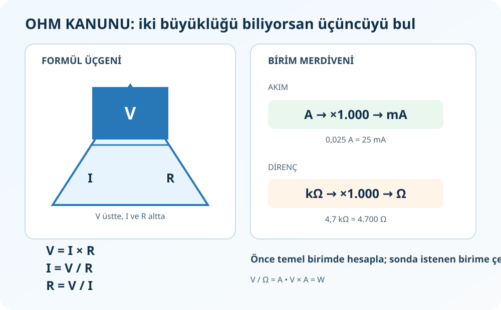

# Elektriksel Büyüklükler ve Birimler

**Kaynak:** *Elektronik Uygulamaları* PDF 18–19, 26–27, 34–35, 70–72. **Frekans/periyot** eki kitapta bu sayfa aralığının dışındadır.

## 1. Dört temel büyüklük

| Büyüklük | Harf | Birim | Basit anlatım | Örnek |
|---|---|---|---|---|
| Gerilim | `V` | volt (V) | Yükleri devrede hareket ettiren elektriksel fark | 9 V pil |
| Akım | `I` | amper (A) | İletkenden geçen elektrik yükü akış hızı | 0,02 A |
| Direnç | `R` | ohm (Ω) | Akım akışına karşı koyma | 470 Ω |
| Güç | `P` | watt (W) | Elektrik enerjisinin kullanılma/dönüşme hızı | 2 W |

Su benzetmesi yalnızca ilk sezgi içindir: gerilimi basınca, akımı akışa, direnci dar boruya benzetebilirsin. Elektrik devresindeki gerçek davranışı hesaplamak için yine devre yasalarını kullan.

## 2. Ön ekler: k, M, m ve µ

Ön ek, sayının kaç kat büyük veya küçük olduğunu gösterir. **Büyük ve küçük harf önemlidir:** `m` mili, `M` mega demektir.

| Ön ek | Değer | Örnek |
|---|---:|---|
| giga `G` | `10⁹` | `1 GHz = 1.000.000.000 Hz` |
| mega `M` | `10⁶` | `1 MΩ = 1.000.000 Ω` |
| kilo `k` | `10³` | `1 kΩ = 1.000 Ω` |
| temel birim | `1` | `1 A`, `1 Ω`, `1 Hz` |
| mili `m` | `10⁻³` | `1 mA = 0,001 A` |
| mikro `µ` | `10⁻⁶` | `1 µA = 0,000001 A` |
| nano `n` | `10⁻⁹` | `1 nF = 0,000000001 F` |
| piko `p` | `10⁻¹²` | `1 pF = 0,000000000001 F` |

### Sık kullanılan dönüşümler

- Akım: `1 A = 1.000 mA`; `1 mA = 0,001 A`; `1 A = 1.000.000 µA`.
- Direnç: `1 MΩ = 1.000 kΩ = 1.000.000 Ω`; `1 kΩ = 1.000 Ω`.
- Güç: `1 kW = 1.000 W`; `1 W = 1.000 mW`.
- Frekans (ek): `1 kHz = 1.000 Hz`; `1 MHz = 1.000 kHz`; `1 GHz = 1.000 MHz`.
- Kapasite: `1 F = 1.000 mF = 1.000.000 µF`; `1 µF = 1.000 nF = 1.000.000 pF`.
- Zaman (ek): `1 s = 1.000 ms = 1.000.000 µs`.

**Örnek:** `0,025 A` kaç mA?

`1 A = 1.000 mA`, dolayısıyla `0,025 × 1.000 = 25 mA`.

**Örnek:** `4,7 kΩ` kaç Ω?

`1 kΩ = 1.000 Ω`, dolayısıyla `4,7 × 1.000 = 4.700 Ω`.

### Birimleri işlemin içinde sadeleştir

Ohm Kanunu'nda `V / Ω = A`. Örneğin `12 V / 240 Ω = 0,05 A = 50 mA`. Önce sonucu temel birimle bul; en sonda sorunun istediği birime çevir.

## 3. Frekans ve periyot — ek konu

- Frekans `f`, bir saniyedeki tekrar sayısıdır; birimi hertz (Hz).
- Periyot `T`, bir tam tekrarın sürdüğü zamandır; birimi saniye (s).
- Birbirlerinin tersidir: `f = 1/T`, `T = 1/f`.

Örnek: Sinyal saniyede 1.000 kez tekrarlanıyorsa `f=1.000 Hz=1 kHz`; `T=1/1.000 s=0,001 s=1 ms`.

**Karıştırma:** `mA` bir akım; `MHz` bir frekans; `ms` bir zamandır. Her biri farklı fiziksel büyüklük olduğundan birbirine dönüştürülemez.

## Alıştırma

1. `0,003 A` kaç mA?
2. `2,2 kΩ` kaç Ω?
3. `470 nF` kaç µF?
4. Frekansı `50 Hz` olan bir sinyalin periyodu kaç ms? (Ek konu)

**Cevap:** 1) `3 mA`. 2) `2.200 Ω`. 3) `0,47 µF`. 4) `T=1/50 s=0,02 s=20 ms`.
