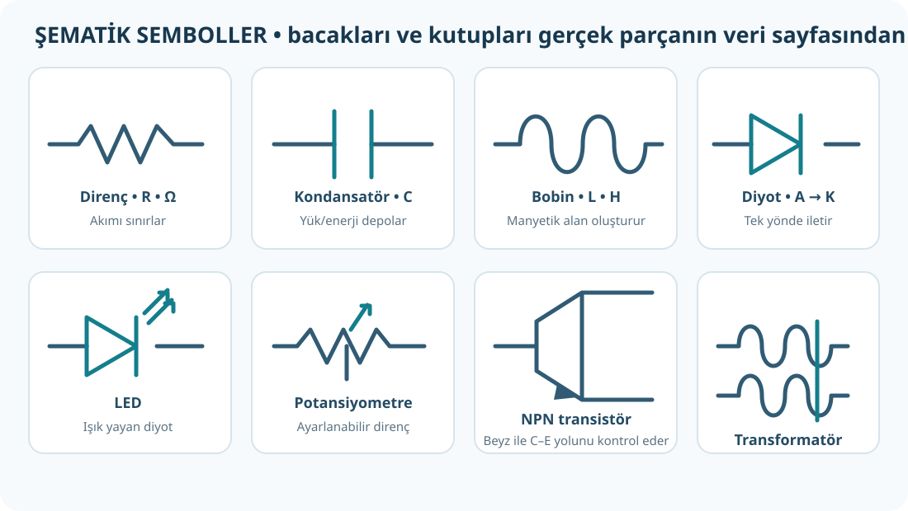

# Devre Elemanları: Ne İşe Yarar, Nasıl Tanınır?

**Kaynak:** *Elektronik Uygulamaları* PDF 18–52. Çizimler kavramları anlatan özgün sembollerdir; kaynak kitap görsellerinin kopyası değildir.

## 1. Direnç ve bakır iletken

Direnç (`R`), akımı sınırlar/belirli bir değere ayarlar. Birimi ohm (Ω). Sabit direnç, potansiyometre, trimpot, reosta ve ışık/sıcaklıkla değişen direnç türleri bulunur.

- **Potansiyometre:** Döner kol ile ayarlanan, çoğunlukla üç uçlu değişken direnç.
- **Trimpot:** Devre kalibrasyonu için tornavidayla ayarlanır.
- **Reosta:** Daha yüksek güçlerde değişken direnç olarak tasarlanır.
- **LDR:** Işık arttıkça direnci genellikle azalır.
- **NTC:** Sıcaklık arttıkça direnci azalır.
- **PTC:** Sıcaklık arttıkça direnci artar.
- **Renk kodu:** 4 bantlı dirençte ilk iki bant rakam, üçüncü çarpan, son bant toleranstır. Örnek: sarı-mor-turuncu-altın → `47 × 1.000 Ω = 47 kΩ ±%5`.

Tel için direnç yaklaşık `R = ρL/A` ile bulunur. Bakır için kitapta verilen yaklaşık öz direnç `ρ=0,0178 Ω·mm²/m`; `L` metre, `A` mm² olmalı. Tel uzadıkça direnç artar, kesiti büyüdükçe azalır.

**Örnek:** 10 m uzunluk ve 1,5 mm² kesit: `R=0,0178×10/1,5≈0,119 Ω`. İki telli gidiş-dönüş bağlantıda toplam tel uzunluğu yaklaşık 20 m olur; direnç yaklaşık `0,237 Ω` çıkar.

> Bu bağıntı ile bir bağlantı telinin direnci hesaplanır. Kontrollü akım sınırlamak için değeri ve güç kapasitesi uygun bir direnç seçilir. İnce teli bilerek ısıtmak güvenli bir güç dönüştürme yöntemi değildir.

## 2. Kondansatör

Kondansatör (`C`), elektrik yükünü/enerjisini elektrik alanında depolar; kapasitesi farad (F). Plakaların alanı ve yalıtkanın dielektrik katsayısı arttıkça kapasite artar; plakalar arası mesafe arttıkça azalır.

- Elektrolitik kondansatör çoğunlukla kutupludur. `+`/`−` uçlarını ters bağlama ve üstündeki gerilim sınırını aşma.
- Seramik/film kondansatörler genellikle kutupsuzdur.
- Kod `104`: ilk iki anlamlı rakam `10`, son rakam pF cinsinden sıfır sayısı `4` → `100.000 pF = 100 nF = 0,1 µF`.
- LCR metre, L (indüktans), C (kapasite), R (direnç) ölçmek için kullanılabilir.

## 3. Bobin

Bobin (`L`), sarılmış iletkendir; birimi henry (H). Akım değişimine karşı koyan manyetik alan oluşturur. DC kararlı hâle geldiğinde esas olarak tel direnci, AC'de ise frekansa ve indüktansa bağlı endüktif reaktans etkilidir. Güç kaynaklarında filtreleme, sinyal ve frekans devrelerinde kullanılır.

## 4. Diyot, LED ve zener

- **Diyot:** Anot (A) ve katot (K) uçludur; ileri yönde iletir, ters yönde büyük ölçüde engeller. Fiziksel diyotta çizgili uç genellikle katodu gösterir.
- **LED:** Işık yayan diyottur; doğru kutuplanır ve akımı sınırlamak için uygun seri dirençle kullanılır.
- **Zener:** Uygun ters kutuplamada ve anma değerleri içinde gerilimi sınırlama/sabitleme için kullanılır.
- **Köprü diyot:** Dört diyotla alternatif akımı doğrultmaya yarar.
- **Diyot testi:** Enerjisi kesilmiş devrede multimetre diyot moduna alınır. Bir yönde ileri gerilim düşümü, ters yönde açık devre okunması genellikle sağlamlık işaretidir.

## 5. BJT transistör

Uçları kolektör (C), beyz (B), emiter (E). Beyz-emiter girişindeki küçük akım, kolektör-emiter yolundaki daha büyük akımı kontrol edebilir; bu yüzden anahtar veya yükselteç olarak kullanılır.

- **NPN:** Bazı kaynak şemalarında emiter oku dışarı doğrudur; doğru çalışma kutuplaması PNP'nin tersidir.
- **PNP:** NPN'ye göre kutuplama yönü tersidir.
- Anahtar: beyz sürülmüyorsa kesim/kapalı; yeterli baz sürmesiyle doyum/açık.
- Bacak dizilimi modelden modele değişir; parça veri sayfasına bak. Kılıf şekline göre tahmin etme.

## 6. Transformatör

İki sargı ve manyetik nüve üzerinden **değişen akımla/AC ile** enerji aktarır. Alçaltıcı tip gerilimi düşürür; yükseltici artırır; izolasyon tipi iki devreyi elektriksel olarak ayırır. Gerilim dönüşümü akım ve güç ilişkisiyle birlikte düşünülmelidir; gerçek elemanda kayıp bulunur. Transformatör tek başına “500 W'ı 50 W'a ayarlamaz”.

## Kendini dene

1. Işık arttıkça direnci azalan eleman hangisi?
2. Sıcaklık artınca direnci artan ve azalan termistörlerin adları ne?
3. `104` kondansatör kodunun değeri?
4. Diyotun katot ucunu tanımaya yarayan yaygın gövde işareti nedir?

**Cevap:** 1) LDR. 2) PTC artar, NTC azalır. 3) `100 nF = 0,1 µF`. 4) Katot tarafındaki bant/çizgi (parça tipini yine veri sayfasıyla doğrula).
