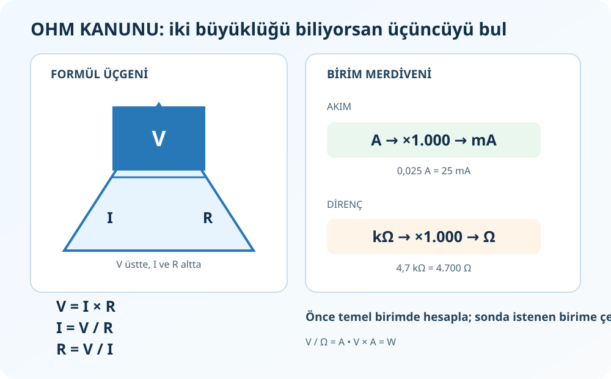

# Ohm Kanunu ve Güç — Hangi Formül, Hangi İşlem?

**Kaynak:** Elektriksel büyüklükler ve devre ilkeleri, *Elektronik Uygulamaları* PDF 18–19 ve 54–65. Güç uygulamalarına dair ek örnekler bu notta ayrıca işaretlidir.



## 1. V, I, R üçlüsü

```text
      V
    -----
     I × R
```

| Sorulan | Formül | Bulduğun |
|---|---|---|
| Gerilim? | `V = I × R` | volt (V) |
| Akım? | `I = V / R` | amper (A) |
| Direnç? | `R = V / I` | ohm (Ω) |

`V` gerilim, `I` akım, `R` dirençtir. Yani verilen iki büyüklüğü formüle koyup üçüncüyü bulursun.

**Örnek:** 12 V kaynağa 4 Ω yük bağlanmış. Akım isteniyor:

1. Bilinenler: `V=12 V`, `R=4 Ω`.
2. İstenen `I`; formülde yalnız bırak: `I=V/R`.
3. Yerine koy: `I=12/4=3 A`.
4. Birim kontrolü: `V/Ω=A`.

`I=V/R`, **bu dirençten** geçen akımı verir. Toplam kaynak akımı soruluyorsa `R` yerine devrenin eşdeğeri `R_T` kullanılır. Bir kol soruluyorsa o kola düşen gerilimi ve kol direncini kullan.

## 2. Güç ne demek?

Güç `P`, elektrik enerjisinin kullanım/dönüşüm hızıdır; birimi watt (W). Dirençli yükler için:

- `P = V × I`
- `P = I² × R`
- `P = V² / R`

`I²`, akımın karesi; `V²`, gerilimin karesi demektir. Üç ifade Ohm Kanunu kullanılarak birbirinden elde edilir. Elindeki verilere uyanı seç; birim kontrolü yap (`V×A=W`).

**Örnek:** 12 V'ta 4 A çeken yük: `P=12×4=48 W`.

## 3. 500 W / 50 W sorusunu doğru ayır

“500 W'lık kaynaktan 50 W almak” iki ayrı durumu anlatabilir:

**Kaynak en çok 500 W sağlayabiliyor, yük 50 W istiyor:** Bu normaldir. Uygun gerilimde yük ihtiyacı kadar akım çeker. Örneğin 12 V, 50 W yük `I=P/V=50/12≈4,17 A` çeker. Kaynağın 500 W kapasitesi yükü 500 W'a zorlamaz.

**Gerçek giriş 500 W, yararlı çıkış 50 W ise:** Verim `η=P_out/P_in×100%=10%`; yaklaşık `450 W` kayıp çoğunlukla ısıya dönüşür. Bu normal/verimli bir düşürme yöntemi değildir.

“500 V'tan 50 V'a” denmek isteniyorsa bu watt değil **gerilim** değeridir. Uygun AC transformatörü veya DC-DC dönüştürücü seçmek gerekir; basit seri direnç özellikle yüksek güçte güvenli çözüm değildir.

## İşlem kontrol listesi

1. Soru benden hangi büyüklüğü istiyor?
2. Devrede o büyüklüğü belirleyen doğru direnç/gerilim hangisi?
3. Birimleri temel birimde mi?
4. Formülün sonucu istenen fiziksel büyüklük mü?
5. Akım amper çıktıysa ve soru mA istiyorsa `×1.000` yaptım mı?
6. Watt hesabında hem gerilim hem akımı hesaba kattım mı?

## Alıştırma

1. 9 V kaynağa 3 kΩ bağlanıyor. Akım kaç mA?
2. 6 V gerilimle 0,2 A akım alan yükün gücü kaç W?
3. 2 W ve 100 Ω dirençte akım `I=√(P/R)` ile kaç A? (Ek formül uygulaması)

**Cevap:** 1) `9/3.000=0,003 A=3 mA`. 2) `6×0,2=1,2 W`. 3) `√(2/100)=√0,02≈0,141 A`.
