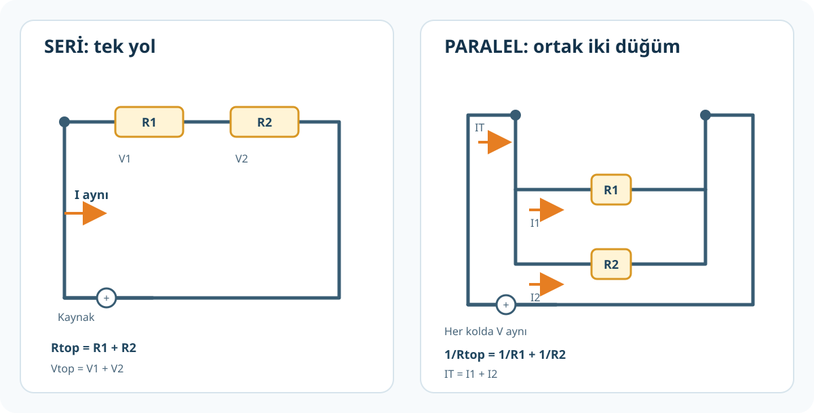
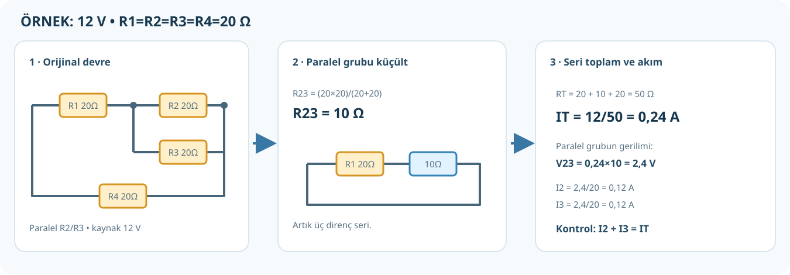

# Seri, Paralel ve Karışık Devreler

**Kaynak:** *Elektronik Uygulamaları* PDF 54–69. Devre şekilleri öğretim için yeniden çizilmiştir; karşılık gelen kaynak PDF sayfaları aşağıda yazılıdır.

## 1. Seri bağlantı

Elemanlar uç uca ve tek akım yolu üzerindedir. Arada başka kol yoktur.

- Aynı akım her elemandan geçer: `I_T = I_1 = I_2`.
- Eşdeğer dirençler toplanır: `R_T = R_1 + R_2 + ...`.
- Kaynak gerilimi dirençlere bölünür: `V_T = V_1 + V_2 + ...`.
- Her dirençte `V_n = I × R_n`.

**Örnek:** 12 V kaynağa 2 Ω ve 4 Ω seri.

1. `R_T=2+4=6 Ω`.
2. `I_T=12/6=2 A`. Bu akım iki dirençten de 2 A geçer.
3. `V_1=2×2=4 V`; `V_2=2×4=8 V`.
4. Kontrol: `4+8=12 V`.

### Kaynak kitap seri örneği

PDF 59–60'da seri bağlantıda devre akımının her elemanda aynı olduğu ve voltmetrenin eleman uçlarına paralel bağlandığı anlatılır. PDF 68'de üç seri direnç sorusunun çözümü [alıştırmalar sayfasındadır](08-alistirmalar.md).

## 2. Paralel bağlantı

Her direnç aynı iki düğüm arasına bağlanır. Kollar ayrı akım yolu oluşturur.

- Kolların uçları aynı düğümlerde olduğundan gerilim aynı: `V_1=V_2=V`.
- Akım kollara bölünür: `I_T=I_1+I_2+...`.
- `I_n=V/R_n`; direnci küçük kola daha fazla akım gider.
- İki direnç için `R_T=(R_1×R_2)/(R_1+R_2)`.
- Genel formül: `1/R_T=1/R_1+1/R_2+...`.
- Eşdeğer direnç en küçük paralel dirençten küçüktür.

**Örnek:** 12 V'ta 6 Ω ve 3 Ω paralel.

1. `R_T=(6×3)/(6+3)=2 Ω`.
2. `I_1=12/6=2 A`; `I_2=12/3=4 A`.
3. `I_T=2+4=6 A`. Kontrol: `12/2=6 A`.

### Aklında kalsın

**Paralelde aynı olan gerilim; ayrılan ve toplanan akımdır.** Her direncin uçlarının gerçekten aynı iki düğüme bağlı olduğunu izleyerek doğrula.

## 3. Karışık devreyi çözme

### Her soruda uygulayacağın 8 adım

1. Kaynağı, dirençleri ve sorulanı yaz.
2. Bağlantı düğümlerini takip et; şeklin görünüşüne aldanma.
3. Önce içteki seri/paralel grubu seç.
4. O grubu eşdeğer dirençle değiştirip yeni, küçük bir devre çiz.
5. Tek bir `R_T` kalana kadar sadeleştir.
6. Toplam kaynak akımını `I_T=V/R_T` ile bul.
7. Orijinal devreye geri dön: seri akımlarını eşitle; paralel gerilimlerini eşitle; her bir elemanı `V=IR` ile hesapla.
8. Kontrol: seri gerilimler kaynak gerilimine, paralel kol akımları ana akıma eşit mi?

> **Yanlış yöntem:** Şemadaki telleri sadece yeniden kıvırıp dirençleri başka düğümlere taşımak bağlantıyı değiştirebilir. Yalnızca iletken üzerinde eleman bulunmayan aynı düğümü sayfa üzerinde farklı biçimde çizebilirsin.

## 4. Tam çözümlü karışık devre (kitap PDF 64–66, Görsel 2.19)

Devre: `R1=R2=R3=R4=20 Ω`, kaynak `12 V`; `R1` seri, `R2` ile `R3` paralel, `R4` tekrar seri.

### A. Toplam akımı bul

1. Paralel grup: `R_23=(20×20)/(20+20)=400/40=10 Ω`.
2. Seri toplam: `R_T=20+10+20=50 Ω`.
3. Kaynak akımı: `I_T=12/50=0,24 A=240 mA`.

### B. Her elemanı bul

4. `R1` ve `R4` seri yolda olduğundan her ikisinden de `240 mA` geçer.
5. Bu dirençlerdeki gerilim: `V_R1=0,24×20=4,8 V`; `V_R4=4,8 V`.
6. Paralel gruba düşen gerilim: `12−4,8−4,8=2,4 V`.
7. Paralel dirençlerin her birinde `2,4 V` bulunur.
8. `I_R2=2,4/20=0,12 A=120 mA`; `I_R3=120 mA`.
9. Kontrol: `120+120=240 mA`; `4,8+2,4+4,8=12 V`.

| Eleman | Akım | Gerilim |
|---|---:|---:|
| R1 | 240 mA | 4,8 V |
| R2 | 120 mA | 2,4 V |
| R3 | 120 mA | 2,4 V |
| R4 | 240 mA | 4,8 V |

## 5. PDF 68–69'daki şekilli soruların kısa yanıtları

| PDF soru | Devre özeti | Çözüm sonucu |
|---:|---|---:|
| 11 | 100 Ω + 300 Ω + 600 Ω seri | `R_T=1.000 Ω` |
| 12 | 3 kΩ paralel 6 kΩ | `R_T=2 kΩ` |
| 13 | 3 kΩ seri (6 kΩ paralel 3 kΩ) | `R_T=5 kΩ` |
| 14 | 15 V, 3 Ω seri (6 Ω paralel 3 Ω), ampermetre ana hatta | `I_T=3 A` |
| 15 | 15 V, 3 Ω seri (6 Ω paralel 3 Ω), voltmetre paralel kolda | `V_ölçülen=6 V` |

Tüm işlem basamakları ve nedenleri [alıştırmalarda](08-alistirmalar.md).

## Alıştırma

`R1=4 Ω` seri; `R2=12 Ω` ile `R3=6 Ω` paralel; kaynak `18 V`.

1. Eşdeğer direnç nedir?
2. Kaynak akımı kaç A?
3. Paralel grup gerilimi ve iki kol akımı nedir?

**Cevap:** `R23=4 Ω`; `R_T=8 Ω`; `I_T=18/8=2,25 A`. `R1` gerilimi `9 V`; paralel grupta `9 V`. `I2=0,75 A`, `I3=1,5 A`; kol akımları toplamı `2,25 A`.
