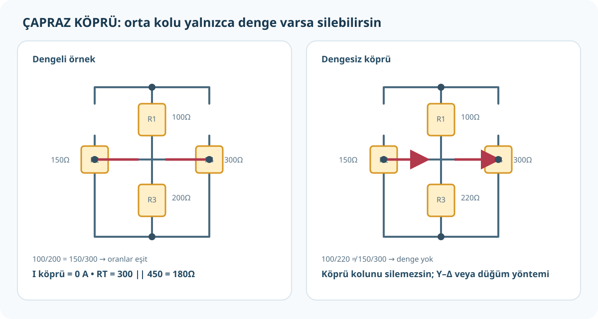

# Çapraz Çizilmiş Devre, Wheatstone Köprüsü ve Yıldız-Üçgen

**Ek konu:** Elektronik Uygulamaları PDF 1–72'de Wheatstone köprüsü/yıldız-üçgen bölümü yoktur. Bu sayfa, öğrencinin bahsettiği çapraz çizilmiş devreler için ek devre analizi anlatımıdır.



## 1. Çapraz çizgi görünce hemen devreyi değiştirme

Bir devre şemasının görünüşünü değiştirmek mümkündür; ancak elektrik bağlantılarını değiştirmek mümkün değildir. Düğüm, aralarında devre elemanı bulunmayan ve iletkenle doğrudan bağlı tüm noktalardır.

- İki tel kesişiyor ama kesişme noktasında birleşme işareti yoksa, çizim kuralına göre bağlantısız olabilir.
- Kesişme noktasında bağlantı noktası (dolu nokta/junction) varsa teller birleşir.
- Bir kablonun geçtiği kavşakta direnç varsa, o direnç iki düğüm arasındaki gerçek bir devre elemanıdır; sırf devreyi seri hale getirmek için silinemez.
- Aynı düğüm üzerindeki uzun telleri farklı biçimde çizmek serbesttir; direnç uçlarının bağlı olduğu düğümleri değiştirmek serbest değildir.

## 2. Köprü biçiminde devre ne zaman sıradan seri-paralel olur?

Önce köprü kolu yok mu diye kontrol et. Sonra:

- İki direncin birleştiği düğümde başka dal yoksa, o iki direnç seri olabilir.
- İki direnç aynı iki düğüme bağlıysa, paraleldir.
- Bu koşullar gerçekleşmiyorsa devre doğrudan seri-paralel değildir.

`R1/R3` sol kolda, `R2/R4` sağ kolda ve `R5` orta köprüde olsun. Kaynağı üst-alt düğümlere bağladığımızda denge koşulu:

`R1/R3 = R2/R4`

Eşdeğer çarpım biçimi: `R1×R4 = R2×R3`.

Denge varsa iki orta düğüm aynı gerilimdedir:

- Orta direnç `R5` üzerinden akım sıfırdır.
- `R5` kolunu hesap dışında bırakabilirsin.
- İki yan kolu seri topla ve birbirine paralel bağla: `R_T=(R1+R3)||(R2+R4)`.

### Denge örneği

`R1=100 Ω`, `R3=200 Ω`, `R2=150 Ω`, `R4=300 Ω`.

`100/200=0,5` ve `150/300=0,5`; köprü dengededir. Orta direnç ne olursa olsun ideal devrede orta kol akımı `0 A`. Sol kol `300 Ω`, sağ kol `450 Ω`:

`R_T=(300×450)/(300+450)=135.000/750=180 Ω`.

## 3. Dengesiz köprü: Yıldız (Y)–Üçgen (Δ) dönüşümü

Denge koşulu yoksa köprü direncini silemezsin. Üç dış düğüm arasındaki Δ bağlantısını aynı uç davranışını veren Y ağıyla değiştirirsen, bazı devreler yeniden seri-paralel hâle gelir.

Δ kenarları `R_AB`, `R_BC`, `R_CA`; dönüşen Y kolları `R_A`, `R_B`, `R_C` olsun. `S=R_AB+R_BC+R_CA`:

```text
R_A = (R_AB × R_CA) / S
R_B = (R_AB × R_BC) / S
R_C = (R_BC × R_CA) / S
```

Her Y kolu: o dış düğüme bağlı iki Δ kenarının çarpımı / üç Δ kenarının toplamı.

**Örnek:** Eşkenar üçgenin her kenarı `3 Ω`. `S=9 Ω`; her Y kolu `3×3/9=1 Ω`. Dönüşümden sonra devreyi yeniden çizip düğüm ve bağlantıları tekrar işaretle.

Y'den Δ'ya dönüşüm gerekirse `Q=R_A R_B + R_B R_C + R_C R_A`:

```text
R_AB = Q / R_C
R_BC = Q / R_A
R_CA = Q / R_B
```

## 4. Yıldız-üçgen dönüşümünü uygulama sırası

1. Dönüşüm yapacağın üç dış düğümü adlandır (`A`, `B`, `C`).
2. Şu an bu düğümler arasında Δ mı, Y mi olduğunu belirle.
3. Üçgen veya yıldız dirençlerini tek tek etiketle; hangi formüldeki kenara ait olduklarını not et.
4. Formülle yeni üç değeri hesapla.
5. Eski üç bağlantıyı çıkarıp yenilerini **aynı üç düğüme** bağla.
6. Yeni devre şeması çiz ve artık seri/paralel grupları bul.
7. Toplam direnci, kaynak akımını ve istenen kol akımlarını/gerilimlerini hesapla.
8. Birim ve fiziksel tutarlılık kontrolü yap.

> Üçgeni yıldıza çevirme, telleri geometrik biçimde bükme değildir; düğümler arası elektriksel eşdeğerliği koruyan direnç dönüşümüdür. Kitapta bu yöntem yok; sınavda kullanılacak yöntemi öğretmenine sor.

## Alıştırma

`R1=100 Ω`, `R3=220 Ω`, `R2=150 Ω`, `R4=300 Ω` ise köprü dengeli mi?

**Cevap:** `100/220≈0,455`, `150/300=0,5`; oranlar eşit değil. Köprü dengesiz, orta kol akımı genel olarak sıfır değildir; köprü direncini silme. Devre/topolojiye göre Y-Δ veya düğüm gerilimi gerekir.
