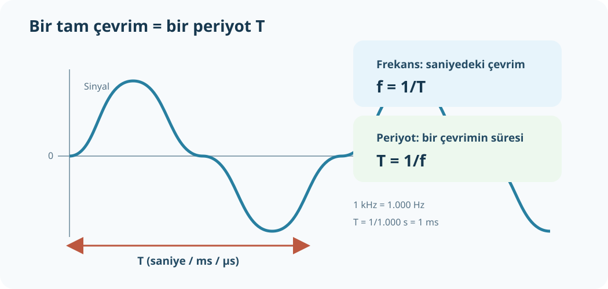

# Frekans, Periyot ve Hz–kHz–MHz

**Ek konu:** Bu başlık *Elektronik Uygulamaları* PDF'sinin ilk 72 sayfasında temel konu olarak yer almıyor. Dalga biçimi ve devre sorularında gereken birim farkını tamamlamak için eklenmiştir.



## Frekans nedir?

Frekans (`f`), tekrar eden bir sinyalin bir saniyede kaç tam çevrim yaptığını söyler. Birimi hertz (Hz).

- `1 Hz`: saniyede 1 çevrim.
- `1 kHz = 1.000 Hz`.
- `1 MHz = 1.000 kHz = 1.000.000 Hz`.
- `1 GHz = 1.000 MHz = 1.000.000.000 Hz`.

## Periyot nedir?

Periyot (`T`), dalganın bir tam çevrimi tamamlaması için geçen süredir. Birimi saniye (s).

```text
f = 1/T         T = 1/f
```

Frekans yükseldikçe periyot kısalır; frekans düşerse periyot uzar.

### Örnek 1 — 50 Hz'in periyodu

`T=1/f=1/50 s=0,02 s=20 ms`.

### Örnek 2 — 2 kHz'in periyodu

Önce `2 kHz=2.000 Hz`.<br>
`T=1/2.000 s=0,0005 s=0,5 ms=500 µs`.

### Örnek 3 — Periyottan frekans

Periyot `T=4 ms`. Önce saniyeye çevir: `4 ms=0,004 s`.<br>
`f=1/0,004=250 Hz`.

## Birimler neden karışıyor?

`MHz` frekans; `mA` akım; `mΩ` direnç; `ms` zaman birimidir. Baş harf ve büyüklük aynı şey değildir. `m` mili, `M` mega; `Hz` çevrim/saniye, `A` elektrik akımıdır.

### Kendini dene

1. `3 MHz` kaç kHz?
2. `1 kHz` sinyalin periyodu kaç ms?
3. `250 µs` periyot kaç Hz?

**Cevap:** 1) `3.000 kHz`. 2) `1/1.000 s=1 ms`. 3) `250 µs=0,00025 s`; `f=1/0,00025=4.000 Hz=4 kHz`.
