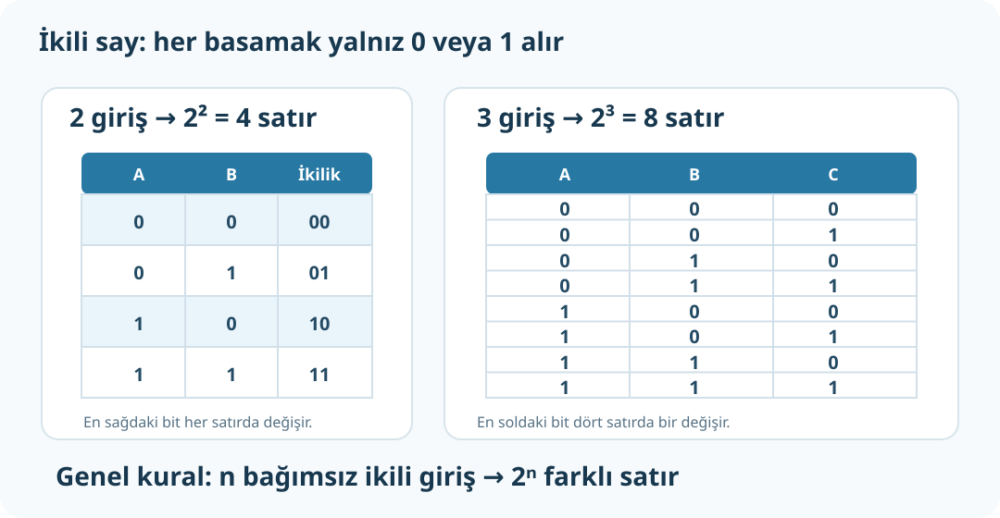

# İkili Sayı Sistemi, Sayma ve Taban Dönüşümleri

**Kaynak:** *Mikrodenetleyici* PDF 18–36. Bu bölümde ikilik (binary), onluk (decimal), sekizlik (octal) ve onaltılık (hexadecimal) sistemler yer alır.



## 1. Basamak ve sayı değeri farklı şeylerdir

Onluk sayı sisteminde on sembol vardır: `0,1,2,3,4,5,6,7,8,9`. Bir sayının basamağının değeri, konumuna göre 10'un kuvvetleriyle belirlenir.

`341₁₀ = 3×10² + 4×10¹ + 1×10⁰ = 300+40+1`.

İkilik sayı sisteminde sadece iki sembol vardır: `0` ve `1`. Basamaklar sağdan başlayarak `2⁰, 2¹, 2², ...` ağırlıklarını alır.

`1100₂ = 1×2³ + 1×2² + 0×2¹ + 0×2⁰ = 8+4=12₁₀`.

**Buradaki `1100` dört bittir ve değeri on ikidir.** Onluk `12` sayısı, “12 tane 1” veya “12 basamak” demek değildir.

| Sistem | Taban | Kullanılan rakamlar | Örnek |
|---|---:|---|---|
| Onluk (decimal) | 10 | 0–9 | `12₁₀` |
| İkilik (binary) | 2 | 0–1 | `1100₂` |
| Sekizlik (octal) | 8 | 0–7 | `14₈` |
| Onaltılık (hexadecimal) | 16 | 0–9, A–F | `C₁₆` |

Onaltılıkta `A=10`, `B=11`, `C=12`, `D=13`, `E=14`, `F=15`.

## 2. İki girişin kombinasyonlarını neden 00, 01, 10, 11 yazarız?

İkili sayma yaparız:

| Onluk sıra | A | B | İki bit |
|---:|---:|---:|---|
| 0 | 0 | 0 | `00` |
| 1 | 0 | 1 | `01` |
| 2 | 1 | 0 | `10` |
| 3 | 1 | 1 | `11` |

İki bağımsız girişin her biri iki değer alır; toplam durum sayısı `2×2=4`. Daha fazla girişte `2ⁿ` kullanılır:

| Giriş sayısı n | Kombinasyon sayısı `2ⁿ` |
|---:|---:|
| 1 | 2 |
| 2 | 4 |
| 3 | 8 |
| 4 | 16 |
| 5 | 32 |

Üç girişli kombinasyonlar `000, 001, 010, 011, 100, 101, 110, 111` şeklinde sayılır. Her bir bit sütunu, sayma boyunca 0 ile 1 arasında düzenli aralıklarla değişir.

## 3. Onluk sayıyı ikiliye çevirme

Onluk sayıyı art arda 2'ye böl. Kalanları **alttan üste** oku.

**Örnek: `12₁₀` → ikilik**

| Bölme | Bölüm | Kalan |
|---|---:|---:|
| 12 ÷ 2 | 6 | 0 |
| 6 ÷ 2 | 3 | 0 |
| 3 ÷ 2 | 1 | 1 |
| 1 ÷ 2 | 0 | 1 |

Kalanları alttan üste oku: `1100₂`. Kontrol: `8+4=12`.

**Örnek: `13₁₀`**

`13÷2=6 kalan1`; `6÷2=3 kalan0`; `3÷2=1 kalan1`; `1÷2=0 kalan1`.<br>
Alttan üste `1101₂`. Kontrol: `8+4+1=13`.

## 4. İkiliden onluya

Basamakları sağdan sola `2⁰, 2¹, 2², ...` ile çarp; sonuçları topla.

`10110₂ = 1×16 + 0×8 + 1×4 + 1×2 + 0×1 = 22₁₀`.

## 5. İkili ↔ onaltılık / sekizlik

- İkili → onaltılık: sağdan başlayıp dörder bitlik gruplara ayır. Her grup bir hex rakamına karşılık gelir.
  - `1100 1010₂` → `C A` → `CA₁₆`.
- Onaltılık → ikili: her hex rakamını 4 bite çevir.
  - `3F₁₆` → `0011 1111₂`.
- İkili → sekizlik: sağdan başlayıp üçer bitlik gruplara ayır.
  - `101 110₂` → `5 6` → `56₈`.

Grup eksik kalırsa en sola sıfır eklenebilir: `1100₂` zaten dört bit; `101₂` sekizlik dönüşümde üçlü gruptur.

## 6. İkili toplama — en çok kullanılan kurallar

| İşlem | Sonuç |
|---|---|
| `0+0` | `0` |
| `0+1` | `1` |
| `1+0` | `1` |
| `1+1` | `10` (0 yaz, 1 elde) |

**Örnek:**

```text
  1011₂  (11)
+ 0110₂  ( 6)
-------
 10001₂  (17)
```

Sağdan sola: `1+0=1`; `1+1=10` (0, elde 1); `0+1+elde1=10`; `1+0+elde1=10`. Sonuç `10001₂=17₁₀`.

Kaynak PDF 20–27'de ikili, sekizlik, onaltılık toplama/çıkarma; ikili çarpma ve bölme örneklenir. Sıfıra bölme matematikte tanımsızdır.

## Alıştırmalar

1. `1011₂` kaç onluk?
2. `12₁₀` ikilikte kaçtır?
3. `111₂ + 1₂`?
4. `10110110₂` onaltılıkta kaçtır?
5. Üç lojik giriş için kaç olası giriş satırı gerekir?

**Cevap:** 1) `11`. 2) `1100₂`. 3) `1000₂`. 4) `B6₁₆`. 5) `2³=8`.
