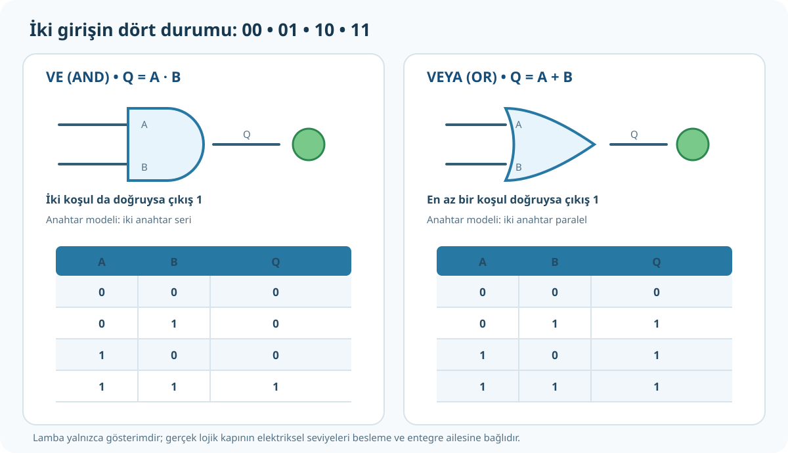

# Doğruluk Tablosu, VE ve VEYA Kapıları

**Kaynak:** *Mikrodenetleyici* PDF 37–40. PDF 37 VE/OR/NOT kapılarını tanıtır; PDF 38'de AND için `00, 01, 10, 11` girişlerini 4081 ile deneyip tablo doldurma; PDF 39–40'da OR uygulaması yer alır.



## 1. Lojik giriş 0 ve 1 ne demek?

İkili dijital devrede giriş bir mantık durumu taşır:

- `0` = LOW/pasif/düşük lojik seviye.
- `1` = HIGH/aktif/yüksek lojik seviye.

Gerçek devrede 0 ve 1, belirli gerilim aralıklarıyla temsil edilir. Hangi voltajın HIGH olduğu entegre ailesine ve besleme gerilimine bağlıdır; her cihazda `1=5 V` diye varsayma.

`A` ve `B` girişlerin; `Q` çıkışın adıdır. Doğruluk tablosu, her giriş durumunda çıkışın ne olduğunu gösterir.

## 2. Tablo satırlarını sıfırdan oluştur

İki giriş, her biri 0 veya 1: dört durum vardır (`2²=4`). İkili sayar gibi yaz:

```text
00
01
10
11
```

Başka satır yoktur: A için 2, B için 2 olasılık; çarpımları 4. Üç giriş olursa `2³=8` satır.

**İpucu:** En sağdaki bit her satırda değişir: `0,1,0,1`. Yanındaki bit iki satırda bir değişir: `0,0,1,1`. Üç girişte en soldaki bit dört satırda bir değişir.

## 3. VE kapısı (AND)

AND, matematikteki **mantıksal çarpma** işlemidir. `Q=A·B` veya `Q=A AND B`.

- Çıkış `Q=1` olması için A **ve** B girişleri ikisi de 1 olmalı.
- Girişlerden en az biri 0 ise çarpım 0 çıkar.

| A | B | Q=A·B |
|---:|---:|---:|
| 0 | 0 | 0 |
| 0 | 1 | 0 |
| 1 | 0 | 0 |
| 1 | 1 | 1 |

Satırları neden böyle?

- `00`: iki koşul da sağlanmıyor → 0.
- `01`: A koşulu yok → 0.
- `10`: B koşulu yok → 0.
- `11`: ikisi de aktif → 1.

**Gerçek hayat modeli:** Makineyi çalıştırmak için güvenlik kapağı kapalı **ve** başlat düğmesine basılmış olmalı. İki koşuldan biri eksikse motor çıkışı aktif olmaz.

### Elektriksel eşdeğer fikri

İki normal anahtarı seri bağla: iki anahtar da kapanınca lambaya yol açılır. Bu, AND mantığını gösteren öğretici modeldir. Gerçek lojik entegre aynı mekanik anahtar bağlantısı değildir.

### Entegreler

Kaynak PDF 38–39'da 4081 ve 7408/74LS08 entegreleriyle VE uygulaması yaptırır. Bir 4081/7408 paketinde birden fazla iki girişli AND kapısı bulunur; gerçek bacak ve besleme bağlantısını kullanılan tam modelin veri sayfasından doğrula.

## 4. VEYA kapısı (OR)

OR, **mantıksal toplama** işlemidir. `Q=A+B` veya `Q=A OR B`. Bu `+`, normal aritmetik toplama değil, “en az bir giriş aktif mi?” sorusudur.

- A veya B'den **en az biri** 1 ise çıkış 1.
- Yalnız ikisi de 0 ise çıkış 0.

| A | B | Q=A+B |
|---:|---:|---:|
| 0 | 0 | 0 |
| 0 | 1 | 1 |
| 1 | 0 | 1 |
| 1 | 1 | 1 |

- `00`: aktif kaynak yok → 0.
- `01`: B aktif → 1.
- `10`: A aktif → 1.
- `11`: ikisi aktif → 1.

**Gerçek hayat modeli:** Alarm iki pencereden **herhangi biri** açıldığında çalışsın. İki sensörün birden alarm vermesi gerekmez.

### Elektriksel eşdeğer fikri

İki normal anahtarı paralel bağla: kollardan biri kapansa bile lambaya akım yolu oluşur. Bu, OR mantığının öğretici modelidir.

## 5. AND ve OR yan yana

| Giriş AB | AND (ikisi de 1 gerekir) | OR (en az biri 1 yeter) |
|---|---:|---:|
| `00` | 0 | 0 |
| `01` | 0 | 1 |
| `10` | 0 | 1 |
| `11` | 1 | 1 |

Girişler `01` veya `10` olduğunda çıkışların farklı olması, iki kapının farklı koşulu test etmesindendir. `11` her iki koşulda da 1 üretir; `00` her ikisinde de 0.

## 6. Doğruluk tablosunu her kapı için oluşturma

1. Giriş sayısını bul (`n`).
2. Satır sayısını `2ⁿ` hesapla.
3. Giriş kombinasyonlarını 0'dan başlayarak ikili say.
4. Kapının kuralını bir cümleyle yaz.
5. Girişleri tek satırda kurala uygula; çıkışı yaz.
6. Örnek satırlarla kontrol et.

**Boş tablo — önce kendin doldur:**

| A | B | AND çıkışı | OR çıkışı |
|---:|---:|---:|---:|
| 0 | 0 |  |  |
| 0 | 1 |  |  |
| 1 | 0 |  |  |
| 1 | 1 |  |  |

Yanıtı sayfanın altındaki [alıştırma cevaplarında](05-alistirmalar.md) kontrol et.

## Alıştırma

Bir makine için `A=kapak kapalı`, `B=başlat düğmesi basılı`, `Q=motor etkin`. Motor ancak kapak kapalı ve düğme basılıyken çalışsın.

1. AND mi OR mu?
2. `A=1, B=0` iken `Q`?
3. `A=1, B=1` iken `Q`?

**Cevap:** 1) AND. 2) `0`, çünkü başlat koşulu yok. 3) `1`, çünkü iki koşul da mevcut.
