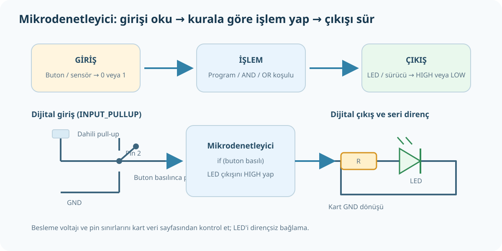

# Mikrodenetleyici, HIGH/LOW, Buton ve LED

**Tamamlayıcı uygulama:** PDF 1–40 sayı sistemleri ve lojik kapı girişine odaklanır. Mikrodenetleyicinin programlanması bu kitabın daha sonraki PDF sayfalarında yer alır; aşağıdaki Arduino benzeri örnek, ilk 40 sayfa dışında başlangıç amaçlı ek açıklamadır.



## 1. Mikrodenetleyici nedir?

Mikrodenetleyici; işlemci, bellek ve giriş/çıkış birimleri aynı çipte bulunan programlanabilir bir kontrol bilgisayarıdır. Sensör veya butondan giriş okur, programındaki kuralları uygular ve LED, buzzer ya da sürücü devresine çıkış verir.

```text
Buton / sensör → dijital giriş → program/lojik → dijital çıkış → LED / sürücü
```

## 2. Dijital giriş, çıkış ve lojik seviye

- **Giriş:** Kartın dış dünyadan okuduğu sinyal (`digitalRead`).
- **Çıkış:** Kartın dış devreye verdiği kontrol seviyesi (`digitalWrite`).
- **LOW:** Lojik 0'a karşılık gelen düşük gerilim aralığı.
- **HIGH:** Lojik 1'e karşılık gelen yüksek gerilim aralığı.

HIGH'ın kaç volt olduğu kart modeline bağlıdır; 3,3 V kartın girişine 5 V uygulamak kartı bozabilir. Üretici sınırını kontrol et.

## 3. Butonla LED örneği

Buton bir dijital girişe; LED ise uygun seri akım sınırlama direnciyle dijital çıkışa bağlanır. Kartta dahili pull-up varsa, aşağıdaki bağlantı örneğinde buton giriş pini ile GND arasında bağlanır. Buton basılınca giriş LOW olur; bırakılınca dahili pull-up HIGH okutur.

```cpp
const int buttonPin = 2;
const int ledPin = 13;

void setup() {
  pinMode(buttonPin, INPUT_PULLUP);
  pinMode(ledPin, OUTPUT);
}

void loop() {
  const bool pressed = (digitalRead(buttonPin) == LOW);
  digitalWrite(ledPin, pressed ? HIGH : LOW);
}
```

Satır satır:

- `buttonPin` ve `ledPin`: kullanılacak pin numaralarını isimlendirir.
- `setup()`: program başlayınca bir kez çalışır.
- `INPUT_PULLUP`: buton girişini kararlı HIGH seviyesinde tutan iç direnci etkinleştirir.
- `OUTPUT`: LED pinini çıkış yapar.
- `loop()`: sürekli tekrarlanır.
- `digitalRead(...) == LOW`: buton basılınca LOW okunacağını hesaba katar.
- `digitalWrite(...)`: basılıyken LED çıkışını HIGH, değilken LOW yapar.

Bazı kartların dahili LED'i 13 numaralı pine bağlıdır; harici LED bağlayacaksan kart pin sınırına uygun **seri direnç** kullan. Pin kapasitesini aşma; motor/röle gibi yükleri doğrudan mikrodenetleyici pininden sürme, uygun sürücü/transistör ve koruma elemanı kullan.

## 4. Mantık kapıları ile bağı

Bir programdaki `if (A && B)` koşulu iki koşulun birlikte doğru olmasını istediğinden AND mantığıdır. `if (A || B)` koşulu en az birinin doğru olmasını istediğinden OR mantığıdır. Donanım kapıları ve yazılımdaki Boole koşulları aynı temel mantık kurallarını kullanır.

## Güvenlik ve bağlantı kontrolü

1. Kartın çalışma gerilimini ve pin eşiklerini kontrol et.
2. GND ortak bağlantısını doğru yap.
3. LED'i dirençsiz bağlama.
4. Güç vermeden önce polarite ve kısa devreyi kontrol et.
5. Şebeke gerilimi veya yüksek akımlı yükü mikrodenetleyici pinine bağlama.
